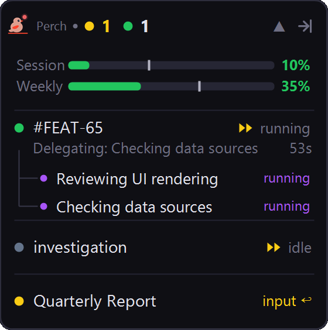

<h1 align="center">Perch</h1>
<p align="center">
 
</p>

<p align="center">
<strong>Know the moment a Claude Code session needs you, and get straight back to it.</strong>
</p>

<br>

Running several Claude Code sessions at once means a lot of checking. Is that one finished? Is this one stuck on
a permission prompt? Perch does the checking for you. It's a **Windows and macOS** tray app that watches every
session in the background and **alerts you** when one finishes, stops to ask you something, or hits an error.

Then it gets you back in with one click, wherever the session lives:

- **Back to the terminal**: Perch brings forward the exact window the session is running in.
- **Back to your IDE**: for a session in VS Code, Cursor or a JetBrains IDE's terminal, it brings the IDE forward
  (Windows).
- **Or never leave Perch**: start and run sessions in Perch's own window. Approve prompts, reply and review
  changes there, or watch every session side by side in **Roost**.

Already know you want it? [Skip the details and install it ▼](#Installing)

📖 Full documentation: **[arcticgizmo.github.io/perch](https://arcticgizmo.github.io/perch/)**

### At a glance

<table>
<tr>
<td width="280" valign="center">

</td>
<td valign="top">

- **See what needs you**: every session in one floating panel, marked **running**, **idle**, **waiting on
  you** or **done**, with counts in the header. The panel flashes when something changes.
- **Get told, wherever you are**: desktop toasts, chimes, and optional push to your phone. When your machine is
  locked, Perch can push every alert so nothing waits on you unseen.
- **Jump straight back**: click a row or a notification to land in that session's terminal or IDE.
- **Or answer from Perch**: approve a permission prompt, reply or run a slash command without leaving the app.
- **Stay ahead of your limits**: 5-hour, weekly and spend bars per account, coloured by whether you're on pace.
- **Quiet when you need it**: Quiet mode silences the fun stuff; a header button toggles Windows Do Not Disturb.

</td>
</tr>
</table>

## How it works

Perch reads Claude Code's own files under `~/.claude/` and updates in near real time. It also adds a few hooks
to Claude Code's settings for you, pointing them at its own small `perch-hook` program. There's no plugin to
install; Perch keeps the hooks current across updates and removes them when you uninstall.

Every session is in one of four states:

| State | What it means |
| --- | --- |
| **Running** | Working, with the current tool call and a timer under it. |
| **Idle** | Open, but not doing anything. |
| **Waiting on you** | Stopped on a permission prompt or a question. |
| **Done** | Finished, and not yet acknowledged. The panel flashes and a notification fires. |

Your session contents never leave your machine. See [PRIVACY.md](PRIVACY.md) for the network features you can
turn on.

## What Perch does

### 1. Tells you when a session needs you

- **The panel**: an always-on-top list of every session with a status dot, the current tool, a timer, and nested
  rows for running sub-agents. Badges show each session's permission mode (Plan, Accept edits, Auto, Bypass).
  It opens itself when something needs you.
- **Notifications**: desktop toasts and system chimes when a session finishes or starts waiting, each type with
  its own toggle and a test button.
- **Push to your phone** via [ntfy](https://ntfy.sh), per session. With the **away override**, a locked
  workstation pushes every session's alerts, so nothing sits waiting while you're away from your desk.
- **Usage and limits**: 5-hour, weekly and monthly-spend bars for each account, with reset times and a marker
  showing where you'd be at a steady pace. Perch only calls the usage endpoint when the bars are on.
- **On your terms**: drag the panel anywhere, shrink it to a slim strip, dock it to a screen edge, reorder its
  sections, or turn on Quiet mode.

### 2. Takes you straight back to it

- **Click a row or a notification** to bring forward the exact terminal window the session is running in.
- **IDE sessions** (Windows): if the session runs in VS Code, Cursor or a JetBrains IDE's terminal, the click
  brings the IDE forward. Perch can show the IDE's icon in place of the status dot, so you can see where each
  session lives.
- **Right-click a row** to open its history, toggle phone push for it, or acknowledge it.
- On macOS, focusing the exact Terminal window needs the one-time **Automation** permission; without it, Perch
  brings the terminal app forward.

### 3. Or runs the session for you

Perch can start and drive Claude Code sessions itself, so the answer to "it needs you" can happen without
switching apps:

- **Session window**: start a session from the panel (pick the folder and account), or run `perch` in a
  terminal. Approve or deny permission prompts, reply, @-mention files, attach images and run slash commands. Tool
  calls show as readable cards, sub-agents get their own tabs, and a changed-files panel tracks what the session
  touched.
- **Roost**: every session side by side in one window, grouped into tabs, with the ones that need you sorted to
  the top. Answer a prompt right in its tile.
- **Pick up where you left off**: restart a session, or resume one from the Recent list, including sessions
  cut off by a shutdown or restart.

### And the rest

- **Stats**: sessions, active time, prompts, tool calls, tokens and estimated cost, by project, branch, tool and
  model, for today, 7 days, 30 days or all time.
- **History and search**: read any past transcript, or search across all of them.
- **Themes**: built-in light and dark themes, plus a designer for making your own.
- **Multiple accounts**: watch several Claude config directories at once, with a warning if a session is
  running under the wrong account.
- **Quick links, to-dos and GitHub alerts** in the panel, a Markdown viewer for a session's docs, a statusline
  designer, and achievements.

The [documentation site](https://arcticgizmo.github.io/perch/) covers each of these in detail.

## Installing

### Windows

```powershell
irm https://raw.githubusercontent.com/ArcticGizmo/perch/main/install.ps1 | iex
```

That's the whole install. No admin rights (it lands in `%LocalAppData%\Perch\`), a Start Menu shortcut and a
normal uninstaller in Settings → Apps, and Perch starts in the tray when it's done. Every update after this
is in-app: right-click the tray icon → **Check for Updates…**.

What the script does, in order: resolves the latest release, fetches `SHA256SUMS.txt` and
`Perch-win-Setup.exe`, **checks the installer against the manifest and deletes it rather than run it on any
mismatch**, then hands off to the installer. It's [`install.ps1`](install.ps1) in this repo — read it before
piping it into your shell, the same as you should with any installer.

Pin a version instead of taking the latest:

```powershell
$env:PERCH_VERSION = '0.2.34'; irm https://raw.githubusercontent.com/ArcticGizmo/perch/main/install.ps1 | iex
```

Because PowerShell rather than a browser does the downloading, nothing is tagged with the mark-of-the-web —
so this route never hits the **"Windows protected your PC"** SmartScreen wall.

### Windows — installer by hand

Prefer to click things: download `Perch-win-Setup.exe` from the
[latest release](https://github.com/ArcticGizmo/perch/releases/latest) and run it. Identical install,
identical self-updates.

A browser download *is* tagged with the mark-of-the-web, so SmartScreen shows the blue **"Windows protected
your PC"** dialog — click **More info → Run anyway**, or use the one-liner above and skip it. To check the
download against the release's `SHA256SUMS.txt` yourself:

```powershell
$want = (Select-String -Path SHA256SUMS.txt -Pattern 'Perch-win-Setup.exe').Line.Split()[0]
(Get-FileHash Perch-win-Setup.exe -Algorithm SHA256).Hash -eq $want   # True
```

### macOS (Apple Silicon, unsigned)

1. Download the `…-osx-arm64.dmg` from the [latest release](https://github.com/ArcticGizmo/perch/releases/latest).
2. Open the `.dmg` and drag **Perch** to the **Applications** folder.
3. Clear the quarantine flag (see below), then launch Perch from Applications.

Every release also publishes a `SHA256SUMS.txt` covering all of its assets, if you want to check the
download first: `shasum -a 256 -c SHA256SUMS.txt --ignore-missing`.

The mac build is **not yet code-signed or notarized**. When macOS downloads an unsigned app it tags it
with a `com.apple.quarantine` flag, and Gatekeeper then refuses to open it — showing **"Perch is damaged
and can't be opened. You should move it to the Trash."** The app isn't actually damaged; that misleading
message just means the quarantine flag is set. Remove it once, from **Terminal**:

```sh
xattr -cr /Applications/Perch.app
```

Then open Perch normally (double-click, or right-click → **Open**). You only need to do this once per
install/update.

> **Note:** on macOS Sonoma/Sequoia the old "right-click → Open" bypass no longer clears a *damaged*
> verdict — you must run the `xattr` command above. If you dragged Perch somewhere other than
> `/Applications`, point the command at wherever `Perch.app` actually lives.

If the `.dmg` **itself** won't open ("damaged"), the quarantine is on the download — clear it on the disk
image first, then reopen it:

```sh
xattr -cr ~/Downloads/Perch-osx-arm64.dmg
```

Perch runs as a menu-bar app — there's no Dock icon. On first launch it symlinks `perch` into
`~/.local/bin`, wires its Claude Code hooks, and may raise one-time macOS prompts: **Notifications**, and
an **Automation** prompt to control Terminal (needed to focus the terminal window running a session — if
you decline, click-to-focus falls back to just bringing the terminal app forward).

## Updating

Perch watches for new releases in the background whichever way you installed it — who *installs* them
depends on the channel:

| Installed with | How it updates |
| --- | --- |
| `install.ps1`, `Perch-win-Setup.exe`, or the `.dmg` | Right-click the tray icon → **Check for Updates…**. Perch downloads the release and restarts itself. |
| Portable zip | Download the new release and replace the folder. |

The one-liner is only a verified download-and-run wrapper around the installer, so an install through it is
an ordinary installed copy — Velopack owns everything from there, and you never need to re-run the script.
Only the hand-extracted portable zip is outside that: Perch will tell you a new version exists but won't
rewrite a directory it doesn't own.

## Building a release (maintainers)

Releases are created by pushing a version tag. GitHub Actions handles the build and publishes the artifacts to the GitHub Release automatically.

**Steps:**

1. Bump `<Version>` in `src/Perch.App/Perch.App.csproj` to the new version (e.g. `0.2.0`)
2. Commit the change
3. Push a matching tag:
   ```
   git tag v0.2.0
   git push origin v0.2.0
   ```
4. GitHub Actions builds and packs both platforms, then the `release` job flattens every artifact into one
   directory, writes `SHA256SUMS.txt` over it, and uploads the lot to the release page

Teammates can then use **Check for Updates...** in the tray to get the new version.

### Checksums (maintainers)

`SHA256SUMS.txt` is generated in the `release` job from the exact files about to be uploaded — never in a
build job — so it can't drift from what users download. It's plain `sha256sum` format, so
`sha256sum -c SHA256SUMS.txt` works on it directly.

Two guards run before it's written, because [`install.ps1`](install.ps1) depends on the result and a silently
wrong manifest is worse than a failed release:

- a duplicate asset basename across the Windows and macOS jobs fails the release rather than publishing one
  of two different files under one name;
- a missing `Perch-win-Setup.exe` fails the release, since the one-liner resolves that asset by name.

`install.ps1` refuses to install a release that has no `SHA256SUMS.txt` — which includes every release
published before this was added, so pinning `$env:PERCH_VERSION` to an old version won't work. If you ever
hand-upload a release, run `publish.bat` (it writes the same manifest into `releases\`) and include the file.

**What this does and doesn't buy.** Checksums prove the bytes you ran are the bytes that were published —
they catch truncated downloads, a proxy or mirror rewriting the payload, and tampering anywhere between
GitHub and the disk. They are *not* a signature: the manifest lives on the same release as the installer, so
anyone who could replace one could replace both. Closing that gap needs code signing (or at minimum GitHub
build-provenance attestation) — see [`docs/distribution-plan.md`](docs/distribution-plan.md).

### Building locally (optional)

If you want to produce release artifacts without pushing a tag, run the packaging script for your platform.
The `vpk` CLI is a local tool pinned in `.config/dotnet-tools.json`, and both scripts restore it for you
(`dotnet tool restore`), so there's nothing to install globally:

```
publish.bat        # Windows: Perch-win-Setup.exe + SHA256SUMS.txt
./publish-mac.sh   # macOS (Apple Silicon): unsigned Perch.app + .dmg
```

Artifacts land in `releases/`. Upload them manually to a GitHub Release tagged to match the version in the
csproj — including `SHA256SUMS.txt`, or `install.ps1` won't install that release. Note that `publish.bat`
hashes everything currently in `releases\`, which accumulates older versions' `.nupkg`s locally; CI starts
from a clean artifact set.

The mac build is arm64-only and unsigned (see the [macOS install note](#macos-apple-silicon-unsigned) for
the Gatekeeper workaround). `publish-mac.sh` builds a styled drag-install DMG (icon-view window with a
"drag Perch → Applications" backdrop and positioned icons) and regenerates its assets on demand if
missing: `Assets/icon.icns` via [`tools/gen-icns.sh`](tools/gen-icns.sh) and the DMG backdrop
`tools/dmg-background.png` via [`tools/gen-dmg-background.sh`](tools/gen-dmg-background.sh) (both use only
stock `swift`/`sips` from the Xcode Command Line Tools).

## Development

Requirements: .NET 10 SDK

```
dotnet run --project src/Perch.App
```

The UI is [Avalonia](https://avaloniaui.net/). To eyeball owner-drawn surfaces without launching the tray,
render them to PNG (1× and 1.5×):

```
dotnet run --project src/Perch.App -- render out
```

### Icons

The app's logo lives in a single source-of-truth vector file, [`perch.svg`](./perch.svg). Every raster
asset — the tray icon, the `.exe` icon, the in-app logo, and the README header — is generated from it,
so the icon stays crisp at any size and there's only one file to edit.

After changing `perch.svg`, regenerate the assets and commit the results:

```
powershell tools/gen-icons.ps1   # PowerShell
tools\gen-icons.cmd              # cmd
# or directly: dotnet run --project tools/IconGen
```

This writes `src/Perch.App/Assets/icon.png` (256×256), `src/Perch.App/Assets/icon.ico`
(multi-resolution), and `landing-icon.png` (512×512).

The macOS app icon (`src/Perch.App/Assets/icon.icns`) is regenerated separately, on a Mac, from
`landing-icon.png` — the IconGen path above renders the SVG through System.Drawing, which only runs on
Windows:

```
tools/gen-icns.sh
```
