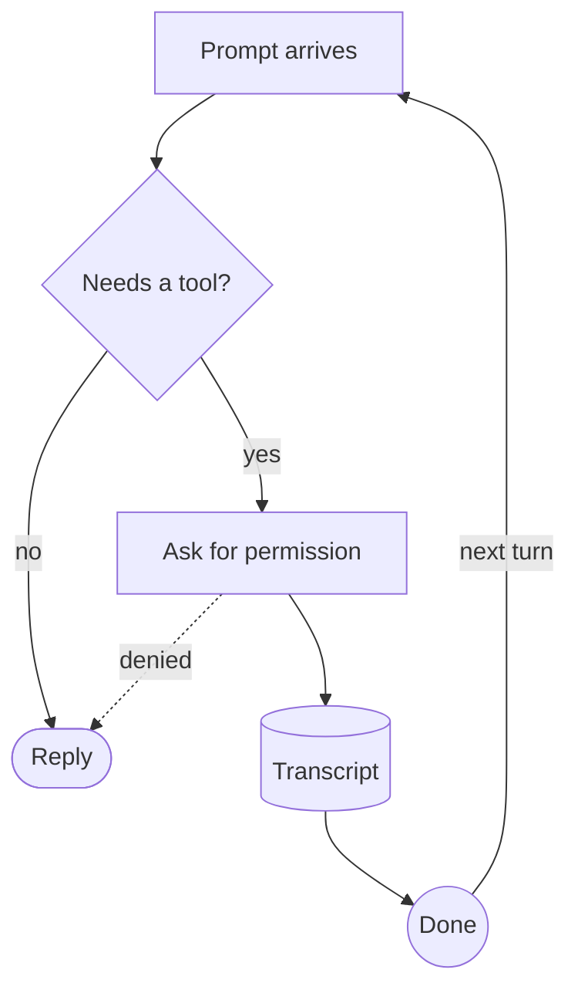
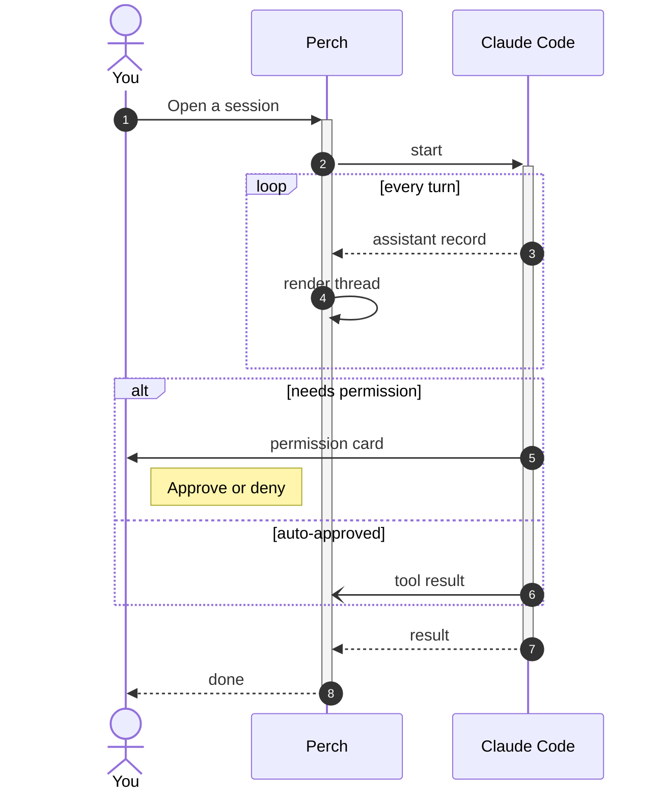
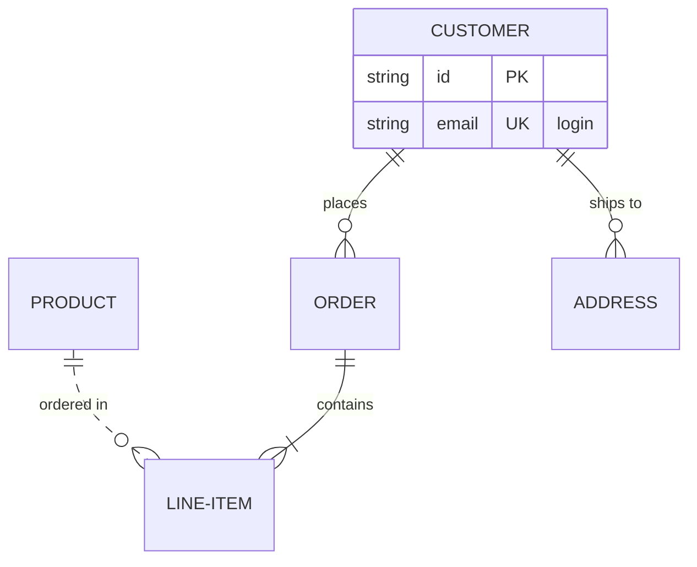

# Mermaid diagrams in the Markdown preview: manual test prompts

Manual checks for drawing ` ```mermaid ` blocks as diagrams instead of code. It adds:

- **A native renderer, no browser.** Mermaid itself is JavaScript and needs a DOM, so Perch has its own parser and layout in `Perch.Core/Data/Mermaid/` (unit-tested in `MermaidTests`). The painter is `Rendering/MermaidDiagramView` and takes its colours from the preview's `MarkdownStyle`, so diagrams follow the light/dark preview theme. Nothing leaves the machine.
- **Three diagram types.** Flowcharts (`graph`/`flowchart`, all four directions, every node shape, every link style and head, link labels, chains, `&` groups, nested subgraphs, edges to a subgraph), sequence diagrams (participants/actors with aliases, every arrow type, `autonumber`, activations, notes, `loop`/`alt`/`opt`/`par`/`critical`/`break`/`rect` blocks, self-messages) and ER diagrams (entities with attribute tables, crow's-foot cardinalities in symbol or word form, identifying/non-identifying lines, aliases, self-relationships). Styling statements (`classDef`, `style`, `linkStyle`, `click`) are ignored on purpose.
- **A fallback for everything else.** Other types (`pie`, `gantt`, `classDiagram`, …) and anything unparseable show as the normal code block under a one-line note saying why.
- **A Source/Diagram toggle** at the top-right of each diagram card, beside a **Fullscreen** button that opens the diagram in a zoomable, draggable dialog (`Windows/MermaidViewerWindow`, `Views/MermaidPanZoom`; the maths is `PanZoom` in Core, unit-tested).
- **Everywhere `MarkdownView` renders.** The Markdown viewer preview, the session window's assistant prose, Work items notes and the feed story player all get it.

The headless render (`render <dir>` → `mermaid_1x.png`, `mermaid_dark_1x.png`, `mermaid_er_1x.png`, `mermaid_er_dark_1x.png`, `mermaid_viewer_1x.png`, `mermaid_viewer_dark_1x.png`, `mermaid_viewer_zoomed_1x.png`) covers the drawing and the viewer's fitted and zoomed states. Only the real app covers the toggle, the viewer's live re-render and the session thread.

## Setup

Run the dev tray: `dotnet run --project src/Perch.App -f net10.0-windows10.0.19041.0`. Make a scratch file, e.g. `C:\temp\mermaid.md`, and open it in the Markdown viewer (open a session's Markdown files and use "Search all project files…", or get a session to write it).

## 1. A flowchart draws instead of showing code

Paste this into the file:

````markdown

````

| | Before | After |
|---|---|---|
| Preview | A grey code panel with the source | A bordered card with boxes, a diamond, a stadium, a cylinder and a circle joined by arrows |
| Labels "yes", "no", "denied", "next turn" | — | Small pills sitting on their arrows, never over a node |
| `F --> A` (the loop back) | — | Curves back up to "Prompt arrives" with its arrowhead at the top node |
| "denied" link | — | Dashed |

## 2. Directions and subgraphs

Change `flowchart TD` to `LR`, then `BT`, then `RL`, and add:

```text
    subgraph Hooks
        H1[/PreToolUse/] --> H2[\PostToolUse\]
    end
    C --> H1
    H2 --> E
```

| | Expected |
|---|---|
| LR / RL | Flow runs left→right / right→left |
| BT | Flow runs bottom→top; the "Hooks" title is still on top of its box |
| Subgraph | A shaded rounded box titled "Hooks" around the two parallelograms, with no other node inside it |
| An edge crossing the title | The title stays readable on its own pill |

## 3. Sequence diagram

````markdown

````

| | Expected |
|---|---|
| Top and bottom | "You" as a stick figure, "Perch" and "Claude Code" as boxes, repeated at the bottom, joined by lifelines |
| Messages | Numbered 1–8 in blue discs; dashed for `-->>`, an open half-arrow for `-)` |
| `+` / `-` | Thin activation bars on Perch and Claude Code from the `+` message to the matching `-` |
| `loop`, `alt` | Framed blocks with a corner tag and a `[label]`; `else` is a dashed divider with its own label |
| Note | A tinted note box to the right of "You" |

## 4. ER diagram

Paste the checklist schema (the "Relationships only" block of `MermaidErSample` in `Rendering/HeadlessRenderer.cs`) into the scratch file, then this below it:

````markdown

````

| | Before | After |
|---|---|---|
| Checklist schema | A note saying ER diagrams aren't drawn, over the source | Sixteen relationships between twelve entity boxes, each line labelled on a pill |
| `CHECKLIST_ITEM }o--o| CHECKLIST_ITEM` | — | A loop on the right of CHECKLIST_ITEM with a marker at each end and "parent (activation condition)" beside it |
| Line ends | — | Crow's-foot markers: two bars for `||`, bar + ring for `o|`/`|o`, foot + ring for `o{`/`}o`, foot + bar for `|{`/`}|` |
| `PRODUCT ||..o{ LINE-ITEM` | — | Dashed (non-identifying); the others are solid |
| CUSTOMER | — | A tinted header band with the name, then rows "string id PK" and "string email UK login" in aligned columns, keys in the accent colour |
| `only one to zero or more` | — | Same markers as `||--o{` |
## 5. Toggle and theme

| Do | Expected |
|---|---|
| Click **Source** on a diagram | The card swaps to the syntax-highlighted source; the button reads **Diagram** |
| Click **Diagram** | Back to the drawing |
| Switch the preview theme (Preview: Light/Dark) | Nodes, lines and text recolour to match; no black-on-dark text |
| Narrow the preview pane until a wide diagram doesn't fit | It scales down to fit and never scrolls sideways; small diagrams keep their size |
| Click on a diagram | The editor caret jumps to the block's opening fence, as for any other block |

## 6. Fullscreen viewer

Click **Fullscreen** on the checklist ER diagram.

| Do | Expected |
|---|---|
| Open | A dialog over the viewer at about 85% of the screen, titled "ER diagram", on the same paper colour as the preview, with the whole diagram fitted and the toolbar reading about 100% |
| Scroll the wheel over a node | Zooms in/out with that node staying under the cursor; the toolbar % follows; text stays sharp at 300%+ |
| Drag | The diagram follows the pointer (move cursor while dragging) |
| Drag far off any edge | It stops with a strip of the diagram still on screen; it can't be lost |
| Double-click | Zooms in 2× about the click |
| **−** / **+** / **Fit** / **100%** buttons, and `-` / `+` / `0` / `1` keys | Zoom out, zoom in about the middle, fit the whole diagram, actual size centred |
| Arrow keys | Pan by a step |
| Resize the dialog before touching it | The diagram refits; after a zoom or drag it stays where you put it |
| First zoom or drag | The hint line at the bottom disappears |
| F11 | True fullscreen; F11 or Esc returns to the dialog |
| Esc / **×** | Closes the dialog; the preview behind is unchanged |
| From a session window's prose | Same dialog, on the session thread's background |
## 7. Fallbacks

| Paste | Expected |
|---|---|
| ` ```mermaid ` + `pie title Pets` + `"Dogs" : 3` | Note "Mermaid “pie” diagrams aren't drawn here yet, so this is the source." over the code block |
| ` ```mermaid ` + `graph TD` + `%% nothing else` | Note "This Mermaid diagram couldn't be drawn, so this is the source." over the code block |
| A flowchart with a typo on one line, e.g. `A --> B ?? junk` | The rest of the diagram still draws; the bad tail of that line is skipped |

## 8. Live typing and sessions

| Do | Expected |
|---|---|
| Type inside a mermaid block in the viewer's editor | The preview re-renders after the usual debounce, with no flicker or freeze |
| Ask a Perch-controlled session to "draw a mermaid flowchart of X" | While the block streams it shows as plain code; once the closing fence arrives it becomes the diagram |

## Not covered

- **Other diagram types** (class, state, gantt, pie, mindmap, timeline, gitGraph, …): source fallback only.
- **Mermaid styling** (`classDef`, `style`, `linkStyle`, `%%{init}%%` themes): ignored; diagrams always use the preview palette.
- **Markdown inside labels** (`"`**bold**`"` strings): the backticks are stripped and the text shows plain.
- **Exact Mermaid layout.** The layout is a cut-down layered (dagre-style) algorithm, so positions differ from mermaid.live, and a very tangled chart can cross more edges than Mermaid would. Charts over 400 nodes fall back to source.
