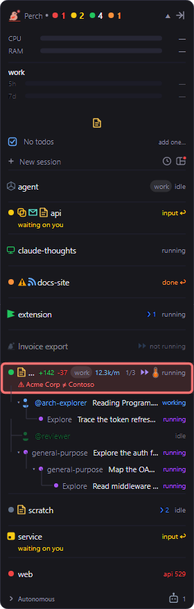

If you run Claude Code under more than one account, for example one config directory per org through
`CLAUDE_CONFIG_DIR`, Perch can watch all of them at once. Sessions and transcripts in each directory are found
and attributed to the right account, and Perch can warn you when a session in a work folder is signed into the
wrong org.

Perch always watches your default `~/.claude` directory. Everything else on this page is about the extra
directories you add.

## Add a config directory

Open **Settings → Config directories**. The list starts with your primary directory, then any you have added.
Each row shows the directory's label, its path, the account it is currently signed into, and whether Perch's
hooks are installed there.

To add one:

1. Click **Add config directory…**.
2. Choose the folder that is a `CLAUDE_CONFIG_DIR` root.
3. Optionally give it a label. The label is shown as a chip on that directory's session rows.
4. Leave **Install Perch hooks** on unless you have a reason not to (see below).
5. Click **Save**.

Perch never adds a directory on its own. A directory is watched only because you added it.

### Scan for directories

Click **Scan for directories** to have Perch suggest likely candidates. It looks for:

- directories a running session reported starting from,
- `~/.claude*` folders in your home directory,
- `claude-envs` environments.

Suggestions are listed under **Found, not added**. Each one has an **Add…** button that opens the same dialog
as a manual add, so you still confirm the label and hooks before anything changes. Nothing found is added
automatically.

### Rename or remove a directory

Click **Edit** on a row to change its label or its hooks setting. The primary directory has no chip unless you
give it a label.

Click **Remove** to stop watching a directory. Perch also takes its hooks back out of that directory's
settings. The primary directory cannot be removed.

To list what Perch is watching from a terminal, run:

```sh
perch configdirs
```

## Hooks and other per-directory switches

Perch's hooks are what drive the accept-edits badge, session control and auto-start. The primary directory is
always hooked. Directories you add are hooked by default, and you can turn hooks off per directory in its
**Edit** dialog.

Some other switches that live in a config directory's own `settings.json` also become per-directory once you
have more than one:

- **Enable Agent Teams in Claude Code** shows a single toggle when you have one directory. With several, it
  shows an **Edit…** button that opens a dialog with a switch for each directory.
- The Claude Code status line is applied per directory from the
  [statusline designer](/perch/features/markdown-statusline/).

## Labels on session rows

When more than one config directory is in play, each session row shows its directory's label as a small chip.
Hover the chip to see which org the directory is signed into. Turn **Config labels** off to hide every chip.

## Usage per account

The usage bars split by account: you get a set of bars for each account that has a session running, plus your
default account. Directories signed into the same account share one set. Accounts you know about but are not
using right now appear as compact chips, checked quietly in the background.

Click an account on the overlay to collapse it to a chip or expand it back. Hovering a set shows only that
account's usage. See [Usage and limits](/perch/features/usage-limits/) for how to read the bars.

## Account guardrails

A guardrail says that everything under a folder must run on one of the accounts you choose. If a session in that
folder is signed into a different org, its row gets a pulsing red outline and a second line naming what was
expected and what it is actually on.



To add one, go to **Settings → Config directories → Account guardrails** and click **Add account rule…**. Pick
a folder and tick the accounts allowed there. The accounts offered are the ones currently signed into your
config directories. When rules overlap, the most specific (deepest) folder wins.

Guardrails only alert. Perch never blocks or stops a session.

The status line can show the same warning: the built-in **Account-aware** status line flags a wrong-account
session in red. See [Markdown viewer & statusline](/perch/features/markdown-statusline/).

## Choose the account for a new session

When you start a session from Perch and there is a choice to make, the new-session screen shows an **Account**
selector. It appears when more than one account is signed in, or when a guardrail covers the folder.

- The selector only offers the accounts a guardrail allows for that folder.
- If only one account is allowed, the selector is locked with a padlock.
- If no signed-in account satisfies the guardrail, a warning says the session will run under your current
  login.

Once a session is running, its footer shows which account it is on (only when you have more than one).
Starting a session from a GitHub pull request follows the same rules. See
[Quick links, to-dos & GitHub](/perch/features/panel-extras/).

## Resuming keeps the account

Perch remembers which config directory each session ran under. When you resume a session, it reopens under the
account it ran under before, not whichever account happens to be your default.

## Settings

| Setting | What it does |
| --- | --- |
| Config directories | Extra Claude Code config directories Perch watches alongside `~/.claude`. Add, scan, rename or remove them. |
| Account guardrails | Warn when a session runs on the wrong Claude account for its folder. Alerting only. |
| Config labels | Show each session's config directory label on its row, when more than one directory is in play. |
| Enable Agent Teams in Claude Code | Turn on Claude Code's experimental Agent Teams feature. Per directory when you have several. |

## Related

- [Usage and limits](/perch/features/usage-limits/)
- [Session window](/perch/features/session-window/)
- [Markdown viewer & statusline](/perch/features/markdown-statusline/)
- [Quick links, to-dos & GitHub](/perch/features/panel-extras/)
