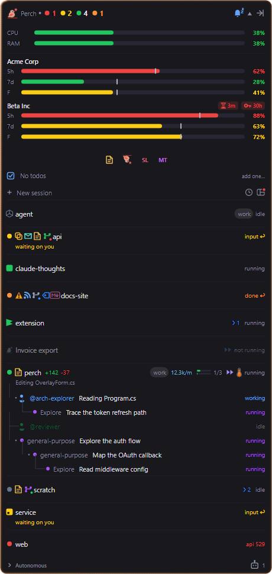
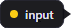
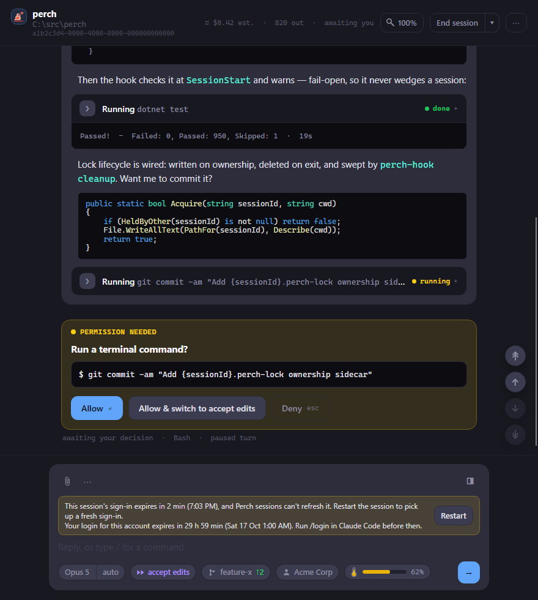

You shouldn't have to keep checking your sessions. Perch alerts you when one finishes, stops to ask you
something or fails, wherever you are, and a click on the alert takes you straight back to it.

## What Perch alerts you about

| Event | When it fires |
| --- | --- |
| Done | A session finished working. |
| Waiting for input | A session is blocked on a permission prompt or a question. |
| API error | A session's last request failed (for example `529 Overloaded`) and it stopped. |
| PR finished | A pull request for a session's branch was merged or closed. |
| PR reviewed | Someone added a review to that pull request, or requested changes. |
| PR approved | Someone approved that pull request. |

The three PR events only fire while the **Pull requests** setting is on, because that's what makes Perch track
a session's PR. See [Panel extras](/perch/features/panel-extras/).

Every session alert does up to four things, each with its own switch:

- **The panel flashes.** A border runs round the overlay for a few seconds, and a collapsed panel expands to
  show the session. This always happens; see [Overlay panel](/perch/features/overlay-panel/).
- **A desktop toast pops up.** Click it to jump to the session. Clicking also marks a done session as read.
- **A chime plays.** Chimes are off until you turn them on.
- **A push goes to your phone**, if you've set up ntfy (below).

For a PR event, Perch can also flash a banner across the session's row on the panel, naming the reviewer or
approver. This banner has its own setting and still works when desktop notifications are off.

If you're already looking at a session in the [Roost](/perch/features/roost/), Perch holds back its toast.
Look away while the session still needs you and the toast fires then.

## Choose which alerts you get

1. Open **Settings** from the tray menu and go to **Notifications**.
2. The switch at the top turns all desktop toasts and chimes on or off.
3. Each event has its own row with a **Pop-up** switch and a **Chime** switch. Turn off the parts you don't
   want.
4. Click **Test** on a row to see that toast and hear its chime, whatever the switches say.

Chimes use the built-in system sounds.

:::note[macOS]
On macOS, Perch plays a system sound for Done, Waiting for input and API error only. The PR events don't chime.
:::

## Push alerts to your phone

Perch can send alerts to your phone, or any device, through [ntfy](https://ntfy.sh). You choose which sessions
push.

1. Install the ntfy app on your phone.
2. In Settings, go to **Notifications** and turn on **External notifications**.
3. Leave **Server URL** as `https://ntfy.sh`, or enter your own ntfy server.
4. Click **Generate** to create a long random **Topic**, then **QR code** to show it so you can subscribe to it
   from your phone.
5. Click **Send test notification**. Perch tells you with a toast whether the push went through.
6. In the overlay, right-click a session and choose **Enable external notifications**. An envelope appears on
   its row. Choose **Disable external notifications** to stop.

A session with push on sends the same events listed above. Pushes don't depend on the desktop **Pop-up** and
**Chime** switches, so you can push to your phone without toasts on your desktop.

Anyone who knows your topic can read your pushes. They carry the session's name and the event, not what's in
the session. Use a generated topic rather than one that's easy to guess.

### Away override

Turn on **Notify any session while my screen is locked** and every session pushes while your workstation is
locked, not just the ones you opted in. Those pushes start with "AFK:" so you can tell why you got them.
Nothing waits on you unseen while you're away from your desk.

### Remote-controlled sessions

Turn on **Include a claude.ai link for remote-controlled sessions** and a push from a session under Claude
Code's remote control carries an **Open session** button that opens it on claude.ai.

## Quiet mode

Quiet mode turns off Perch's playful features for a while, without touching your session alerts.

1. Right-click the overlay header.
2. Choose **Quiet mode**, then **For 30 minutes**, **For 1 hour**, **For 2 hours** or **Until tomorrow morning**
   (7 am).

While Quiet mode is on, the Perch logo in the header is replaced by a sleeping glyph. To end it early,
right-click the header and choose the **Quiet mode: on** item, which also shows the time left. It stays on
through a restart until its time runs out.

Quiet mode switches off these settings while it lasts, and puts them back afterwards:

- Perch reacts
- Achievement reveal card and Achievement toasts
- Upside-down quick links
- Desktop basketball
- Notify on new feed entries
- Social feed, Notify when a friend posts and Show large reactions, along with the other social toasts

Done, waiting, API error and PR alerts carry on as normal.

## Do Not Disturb button

:::note[Windows only]
macOS doesn't let an ordinary app switch Focus on and off, so the button isn't offered there.
:::

Turn on the **Do Not Disturb button** setting to add a sleeping bell to the right of the overlay header. It's
lit while Windows Do Not Disturb is on. Click it to turn Do Not Disturb on or off.

## Dense strip bubbles

When the panel is shrunk to the dense strip, a state change can either open the full panel or float a small
bubble off the logo that fades after a moment. Choose with **Dense strip status changes** (Expand or Bubble).

## Sign-in expiry

Claude Code's sign-in has two clocks: the access token, which Claude Code refreshes on its own, and the login,
after which you have to run `/login` again. With **Sign-in expiry** on, Perch watches both for each account in
the usage strip:

- An hourglass chip appears next to the account's name when its access token is about to expire or has
  expired.
- A key chip appears when the login expires within two days.

Hover the usage strip to read both clocks in full. See [Usage & limits](/perch/features/usage-limits/).

A session that Perch runs in its own window can't refresh its access token. Its window shows a banner above
the reply box before the token runs out, with a **Restart** button to pick up a fresh sign-in. The banner also
warns when the account's login is about to expire.

## Other notifications

A few other features raise their own toasts, each with its own setting: **Todo reminders** when a to-do is due,
**Notify on new feed entries**, and **Notify when a friend posts**. See
[Panel extras](/perch/features/panel-extras/) and [Social](/perch/features/social/).

## Settings

Open **Settings** from the tray menu. Type a setting's name into **Search** to find it. The Notifications page
has the same switches laid out by event, with the Test buttons.

| Setting | What it does |
| --- | --- |
| Desktop notifications | Master switch for desktop toasts and chimes. On by default. |
| Notify when done | Toast when a session finishes. On by default. |
| Notify when waiting for input | Toast when a session is blocked on a prompt. On by default. |
| Notify on API error | Toast when a session's request failed and it stopped. On by default. |
| Notify when a PR finishes | Toast when a tracked PR is merged or closed. On by default. |
| Notify when a PR is reviewed | Toast when a tracked PR gets a new review. On by default. |
| Notify when a PR is approved | Toast when a tracked PR is approved. On by default. |
| Flash a PR state banner | Flashes a banner over the session's row on a PR change. On by default. |
| Chime when done | Sound when a session finishes. Off by default. |
| Chime when waiting | Sound when a session needs input. Off by default. |
| Chime on API error | Sound when a session errors. Off by default. |
| Chime when a PR finishes | Sound when a PR is merged or closed. Off by default. |
| Chime when a PR is reviewed | Sound when a PR gets a review. Off by default. |
| Chime when a PR is approved | Sound when a PR is approved. Off by default. |
| External push (ntfy) | Turns on pushes through ntfy. Off by default. |
| ntfy server | The ntfy server pushes go to. |
| ntfy topic | The topic pushes are published to. |
| Push while screen locked | The away override: every session pushes while your screen is locked. Off by default. |
| Include claude.ai link in push | Adds an Open session link to a remote-controlled session's push. Off by default. |
| Do Not Disturb button | Adds the Do Not Disturb bell to the header. Off by default. Windows only. |
| Dense strip status changes | Expand the panel, or show a bubble, on a state change in the dense strip. |
| Sign-in expiry | Shows the sign-in countdown chips on the usage strip. On by default. |

## Related

- [Overlay panel](/perch/features/overlay-panel/)
- [Jump back to a session](/perch/features/jump-back/)
- [Usage & limits](/perch/features/usage-limits/)
- [Roost](/perch/features/roost/)
