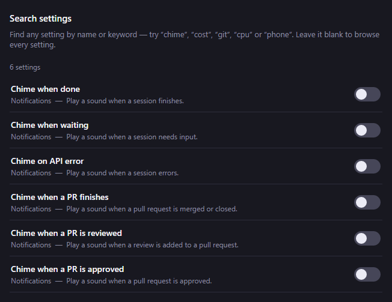
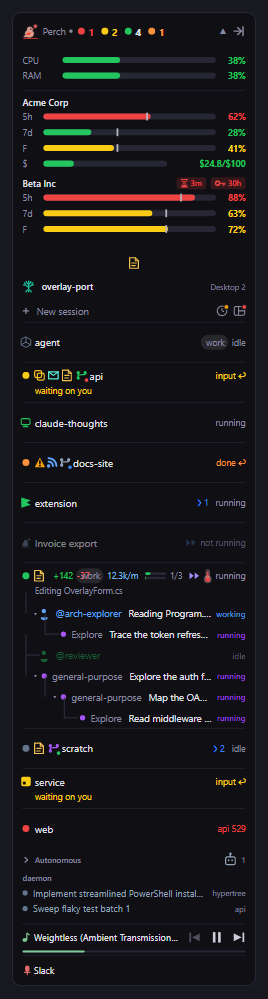

Perch has built-in dark and light themes and a designer for making your own. Every other option lives in
one Settings window, which you can search by name.

## Open Settings

Left-click the tray icon, or right-click it and choose **Settings…**. The window opens on the **Features**
page. Press **Ctrl+F** anywhere in it to jump to **Search**.

## Choose a theme

Go to **Settings → Appearance**. Each theme is a card with its name, a Dark or Light tag and a strip of
swatches. Click a card to switch: the whole app recolours at once, including the overlay and every open
window.

The built-in themes are:

- **Midnight** (the default)
- **Ember**
- **Blush**
- **Dim**
- **High Contrast**
- **Winamp**
- **Daylight** (light)

There are also imported palettes in both a dark and a light version, such as **Nord (Dark)** and
**Nord (Light)**. They include Nord, Gruvbox, Solarized, One, Tokyo Night, Rosé Pine and Sepia.

Every built-in theme is checked against WCAG AA contrast. The status colours (running, waiting, error and
so on) are tuned to stay easy to tell apart in every theme.

## Design your own theme

Click **+ Design a new theme…** on the Appearance page. The designer starts from your current theme and
applies every change live across the app as you edit.

- **Start from:** pick any built-in or imported theme as the base.
- **Name:** what the theme is called in the list.
- **Chrome tint (hue and strength):** re-tints the window and overlay surfaces in one go.
- **Accent colour:** links, highlights and selected controls.
- **Status glyphs:** recolour any of the overlay's status colours, such as Running, Awaiting, Error,
  Sub-agent or Burn rate.

The **Contrast (WCAG)** readout checks text and glyph pairs as you go. Text needs AA contrast and glyphs
need 3:1 against the overlay. A failing pair shows **FAIL** with a **Fix** button that adjusts the colour
until it passes.

Click **Save theme** to add it to your list, or **Cancel** to put your previous theme back. A saved custom
theme has **Edit** and **Delete** buttons beside its card.

### Colour-blind preview

The designer's **Colour-blind preview** buttons (**Normal**, **Protan**, **Deutan**, **Tritan**) simulate
protanopia, deuteranopia and tritanopia on the live preview. Use them to check the status colours stay
distinguishable. Only the preview is simulated: the saved theme and the contrast readout use the real
colours.

## Share a theme

Themes travel as a short text code.

- **Copy active as code** copies the current theme to the clipboard.
- **Import from clipboard** reads a code from the clipboard, adds it to your custom themes and switches to
  it. Anything that is not a Perch theme code is ignored.

## Find a setting

**Search** filters every setting by name and keyword. Try words like "chime", "cost", "git" or "cpu".
Leave it blank to browse the full list. Toggles can be switched straight from the results.

Setting names in these docs match the names in Settings, so you can paste one into Search to find it.

## Browse features by surface

The **Features** page shows every setting as a card, grouped by where it appears:

- Session row
- Usage bars
- System & metrics
- Notifications
- Tray & stats
- Whimsy
- Integrations
- Social
- Advanced

Use **Filter features…** or the surface chips to narrow the list. Toggles and number settings can be
changed on the card, and take effect straight away.

A few settings only work on some systems and are hidden where they can't work. For example, the docked
overlay mode is Windows only.

## Live preview

The **Live preview** pane beside the Features and Appearance pages is a miniature copy of the overlay with
sample sessions. It redraws as you change a setting or theme, so you can see the effect before you look
at the real overlay.

On the Features page, **Rearrange** under the preview lets you drag the overlay's sections into a new order.
See [Overlay panel](/perch/features/overlay-panel/).

## Other Settings pages

Some options have their own page because they need more than a switch: **Getting started**,
**Session Stats**, **Achievements**, **Notifications**, **Social**, **Shortcuts**, **Quick Links**,
**Feeds**, **Config directories**, **Export**, **About** and **Changelog**.

## Quiet mode

Quiet mode temporarily turns off Perch's playful extras without changing your settings. See
[Alerts](/perch/features/alerts/).

## Settings

| Setting | What it does |
| --- | --- |
| Theme | The app's colour theme. Pick a preset or design your own on the Appearance page. |

## Related

- [Overlay panel](/perch/features/overlay-panel/)
- [Alerts](/perch/features/alerts/)
- [Stats & achievements](/perch/features/stats-achievements/)
