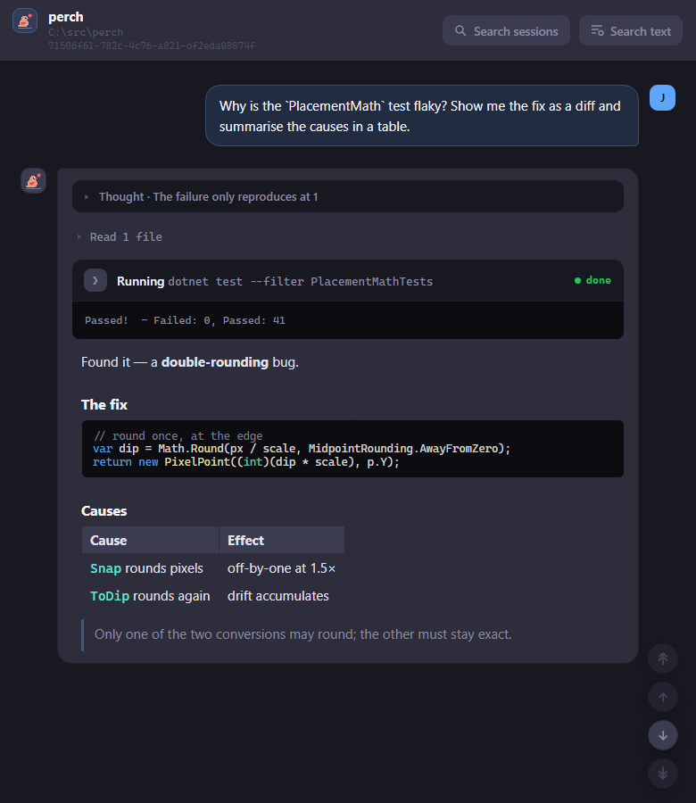
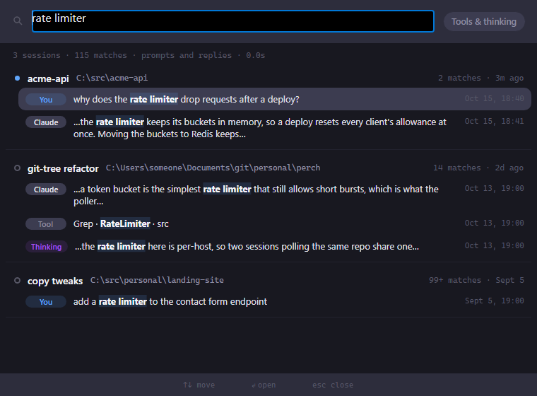
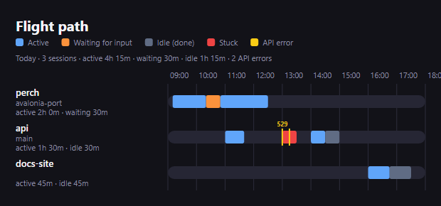

Perch can open any Claude Code transcript on your machine, live or finished, and render it the same way a
live session looks. You can also search the text of every transcript at once and land straight on the hit.

## Open the history viewer

Open it in any of these ways:

- Right-click the tray icon and choose **Session history…**.
- Right-click a session on the overlay and choose **View history**.
- Right-click a daemon worker row or a not-running Perch session and choose **View history**.

Opening from a session row loads that session straight away. Opening from the tray shows an empty viewer:
click **Search sessions** in the toolbar to pick one.

The viewer is read-only. It shows the same prompt bubbles, tool cards, diffs and Markdown as the
[session window](/perch/features/session-window/), with no composer or controls.

- The header shows the session's name, its working folder and its session id. Click the id to copy it.
- Floating buttons at the bottom right jump to the top, the previous prompt, the next prompt and the bottom.
  A button is dimmed when it has nowhere to go.
- File paths in tool cards and code open in Perch's Markdown viewer, or as a diff in the git tree.
- A finished transcript opens at the top. A session that is still running opens at the end.

### Pick a session

**Search sessions** opens a small palette over the viewer. Type to filter by name, folder or session id.
Use the arrow keys to move, Enter to open the highlighted session, and Esc to dismiss. Each row shows
whether the session is live, its folder, when it last ran and the transcript's size.

### Follow a live session

If the session is still running, the viewer follows it. New lines are added as Claude Code writes them,
without reloading, so your scroll position and any expanded tool cards stay put.

### Large transcripts

Transcripts of 10 MB or more are not loaded automatically, because they can be slow to render. Perch
shows the size and a **Load anyway** button instead.

## Search every transcript

To find a conversation by what was said in it, right-click the tray icon and choose
**Search transcripts…**, or click **Search text** in the history viewer's toolbar.

- Type at least two characters. Matching is case-insensitive.
- Results stream in as transcripts are scanned, grouped by session with the newest first and running
  sessions at the top.
- Each session shows its match count and up to three one-line excerpts, labelled **You**, **Claude**,
  **Tool** or **Thinking**.
- By default only your prompts, Claude's replies and agents' reports are searched. Turn on
  **Tools & thinking** to also search tool calls, tool output and Claude's thinking.
- Use the arrow keys to move between hits, Enter to open one, and Esc to close.

The window stays open while you read, so you can try the next hit without searching again.

### Land on a hit

Opening a hit loads that session in the history viewer and opens the find bar on your search, with the
first match in that part of the conversation selected. Step through the rest from the find bar.

## Find in a conversation

Press **Ctrl+F** in the history viewer to open the find bar. Every match is highlighted and the current one
is scrolled into view, with an "n/m" counter beside the box.

- Enter goes to the next match, Shift+Enter to the previous one. The arrow buttons do the same.
- Esc closes the find bar. Press Esc again to close the window.

The same find bar works in the live [session window](/perch/features/session-window/).

## See a day as a timeline

The flight path shows one day of work as a timeline, with one lane per session. Each lane is coloured by
state: active, waiting for input, idle (done) or stuck. API errors are marked with their status code, and a
dashed line marks the current time.

Open it from the tray menu (**Flight path…**) or from **Settings → Session Stats → Open flight path…**.
Use the ‹ and › buttons, or the left and right arrow keys, to move between days. **Today** jumps back.

## Export a session for replay

**Settings → Export** saves a session as a portable `.perchreplay` recording. Pick the session, then click
**Export…** and choose where to save it.

**Redact content (recommended)** is on by default. It removes message text, tool input and output, file
paths, titles and the git branch, and keeps only the structure, timings, token counts and models. Turn it
off only for a private recording you will not share: a raw recording contains your session word for word.

Play a recording back through Perch with `perch replay <recording>`.

## Related

- [Session window](/perch/features/session-window/)
- [Jump back to a session](/perch/features/jump-back/)
- [Stats & achievements](/perch/features/stats-achievements/)
