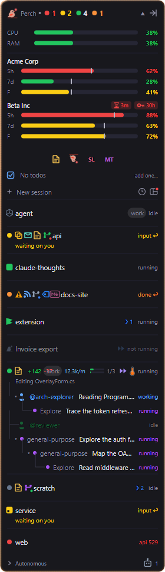

Once Perch has told you a session needs you, the next step is getting back to it. Click its row on the overlay,
or click its notification, and Perch brings the right window to the front: the exact terminal, the IDE, or
Perch's own session window.



## Click a row to focus its terminal

Click any session row on the overlay. Perch works out which window owns that session by walking up from the
Claude Code process to the app that started it, then brings that window forward.

- A minimised window is restored. A maximised one stays maximised.
- If the window is on another virtual desktop, Windows switches to that desktop.
- If two windows of the same app could match (two VS Code windows, say), Perch picks the one whose title
  contains the project name.
- Terminals that Windows Terminal adopted from elsewhere (for example a console launched from Explorer or
  another app) are found too.
- Clicking a row also clears its "done" badge.

Clicking a sub-agent row focuses its parent session.

:::note[Windows Terminal tabs]
Perch focuses the Windows Terminal window, but it can't switch tabs inside it. If the session is in a
background tab, you land on the right window and pick the tab yourself.
:::

### When there's no window

Some sessions have nowhere to go back to:

- **No terminal on screen.** If the session is still running but has no window, Perch shows a
  **No window to focus** notification with its process ID. Right-click the row and choose
  **Terminate session…** if you want to stop it.
- **Autonomous (SDK) sessions.** These run in the background with no window. Clicking one tells you so.
- **Claude Desktop sessions.** Perch brings the Claude Desktop window forward. If Claude Desktop has no window
  open, Perch launches it for you.

## Click a notification

Clicking a desktop notification for a session focuses that session's terminal, the same way a row click does,
and clears its "done" badge. If the window can't be found, nothing else happens: you won't get a second
"no window" notification on top of the first.

## Sessions in an IDE or Claude Desktop

A session running inside an editor's terminal is focused the same way: Perch brings the editor window forward.
Perch recognises:

- Visual Studio Code (and Insiders), VSCodium, Cursor and Windsurf
- JetBrains IDEs: IntelliJ IDEA, PyCharm, WebStorm, PhpStorm, RubyMine, RustRover, DataSpell, DataGrip,
  GoLand, CLion, Rider, Aqua and Fleet
- Zed and Visual Studio
- Claude Desktop

With **IDE status icons** on (the default), a hosted session's row shows its app's icon in place of the
status dot, tinted to the status colour, so you can see at a glance where each session lives. VS Code, Cursor,
Windsurf and JetBrains IDEs get their own icons; the others use a generic one. Turn the setting off to see the
plain coloured dot.

:::note[Windows only]
Detecting which IDE hosts a session works on Windows only for now. On macOS, IDE-hosted sessions show the
plain status dot.
:::

## On macOS

On macOS, Perch focuses the exact **Terminal** window and tab running the session. To do that it needs the
**Automation** permission, which macOS asks for the first time you click a session.

If you decline, or for any other terminal app (including iTerm2), Perch brings the terminal app forward
instead of a specific window. You can grant the permission later in **System Settings → Privacy & Security →
Automation**.

## Sessions Perch runs

Sessions you started in Perch (marked with the Perch mark, "Perch session" on hover) live in Perch's own
window, not a terminal. Clicking their row brings that window forward, or reopens it if you closed it. See
[The session window](/perch/features/session-window/).

A Perch session that is "not running" (for example after Perch restarted) opens in its window too, ready for
you to reply and wake it.

## Move a terminal session into Perch

To carry on a terminal session inside Perch's window, right-click its row and choose
**Elevate to Perch (PoC)…**. Perch asks first, then stops the terminal's Claude process and resumes the same
conversation in a Perch session window. The old terminal may print some teardown output; you can close it.
In [the Roost](/perch/features/roost/), the same action is **Take over in Perch** on a terminal session's pane.

This is a proof of concept and only appears for terminal sessions Perch doesn't already run.

## Keyboard shortcuts

These global shortcuts work from anywhere. Change or turn them off on the **Keyboard shortcuts** page in
Settings.

| Shortcut | What it does |
| --- | --- |
| Alt+Shift+S | **Jump to next session**: focuses the next active session's window, one press at a time. |
| Alt+Shift+Space | **Open session switcher**: a search box in the middle of the screen. |
| Alt+Shift+R | **Open the Roost**: every session side by side. |
| Alt+Shift+W | **Expand / collapse the overlay**. |

### The session switcher

Press **Alt+Shift+Space**, type part of a session's name, project or folder, and press **Enter**.

- Active sessions are listed first. **Enter** jumps to that session's window.
- Below them are recently closed sessions. **Enter** reopens one in a new terminal, running
  `claude --resume` in its folder. If no terminal can be launched, the command is copied to your clipboard.
- **Ctrl+Enter** copies the `claude --resume` command instead.
- **Esc**, clicking away, or pressing the shortcut again closes it.

On Windows, **Reopen sessions in** (on the Keyboard shortcuts page) chooses the terminal used to reopen
sessions: Automatic (Windows Terminal, else Command Prompt), Windows Terminal, PowerShell or Command Prompt.

## The `perch` command

Perch adds a `perch` command to your PATH. Run it in a terminal to open a new session in Perch's own window,
in the current folder, on the same monitor as your terminal. If the tray isn't running yet, it starts in the
background and your prompt comes straight back, like `code .`.

```sh
perch                      # new session in the current folder
perch C:\src\my-project    # new session in another folder
perch --continue           # continue the most recent session in this folder
perch --resume             # pick a recent session to resume
perch --resume <id>        # resume a session by id
perch --tray               # start the tray only, no session
perch --help               # list every option
perch --version            # print the version
```

`--model <name>` and `--permission-mode <mode>` set how a new session starts. `-c`, `-r`, `-h` and `-v` are
short forms of `--continue`, `--resume`, `--help` and `--version`.

Starting Perch any other way (the Start Menu, login, a double-click) only starts the tray.

:::note[Windows: perch.com]
On Windows, Perch installs a small `perch.com` beside `perch.exe`. PowerShell and Command Prompt pick it first
when you type `perch`, so they wait for the command to finish and its output lands before your next prompt.
You don't need to do anything to use it.
:::

## Settings

| Setting | What it does |
| --- | --- |
| IDE status icons | Show the host app's icon in place of the status dot for sessions in an IDE or Claude Desktop. Off shows the plain coloured dot. |

The global shortcuts and **Reopen sessions in** are on the **Keyboard shortcuts** page in Settings.

## Related

- [The overlay panel](/perch/features/overlay-panel/)
- [Alerts and notifications](/perch/features/alerts/)
- [The session window](/perch/features/session-window/)
- [The Roost](/perch/features/roost/)
- [History and search](/perch/features/history-search/)
