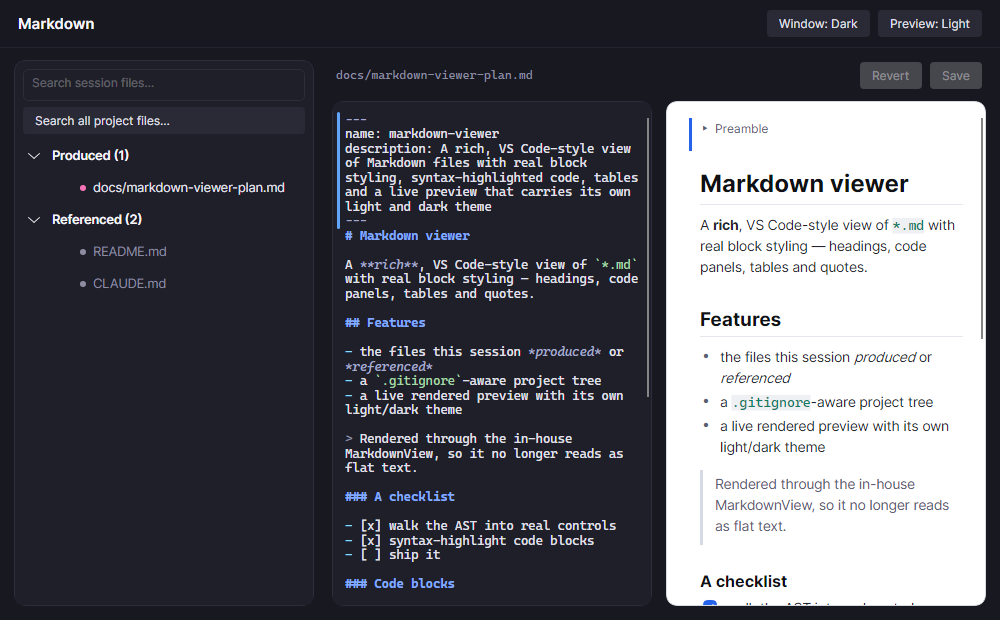
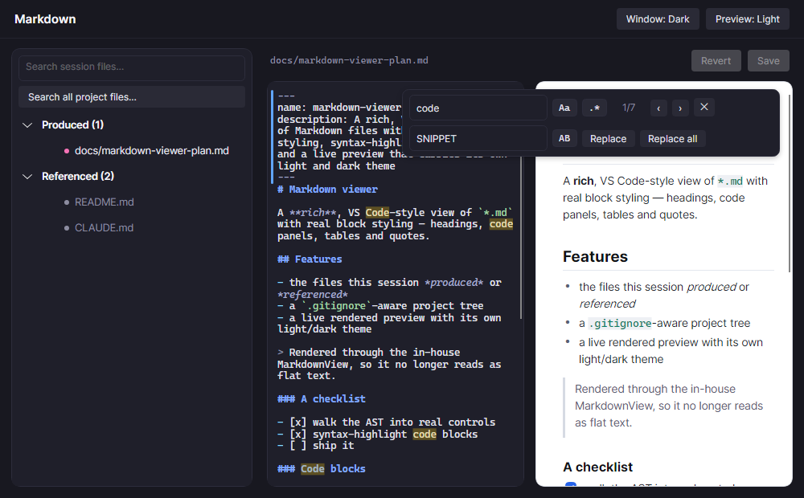
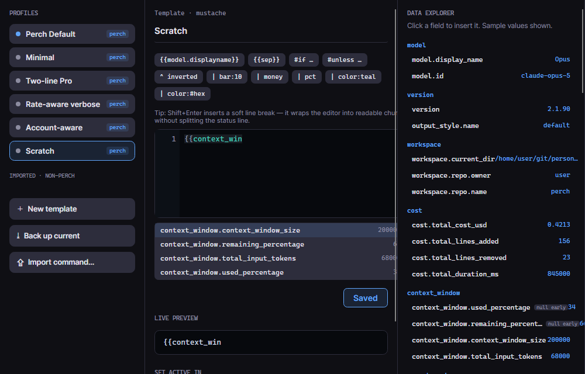

Claude often writes plans, notes and READMEs as Markdown. Perch's Markdown viewer lets you read and edit them
next to a live preview. The statusline designer lets you build the status line Claude Code shows in the
terminal, with a live preview, and apply it to any of your config directories.

## Open the Markdown viewer

There are a few ways in:

- Right-click a session on the overlay and choose **Markdown files…**. This item is always there.
- Click the Markdown glyph on a session row. With **Markdown glyph** on, it appears on any session that
  produced a `.md` file.
- In a session window, Ctrl+click a Markdown file path to open it in the viewer.

The left pane lists the files that session **Produced** and the ones it **Referenced**. The list updates live as
files are added or edited. Type in the search box to filter it, or click **Search all project files…** to search
every Markdown file in the project. That search respects `.gitignore`.

## Read and edit

Selecting a file opens it in a split view: the source editor on the left and a rendered preview on the right.
Both are syntax highlighted, and clicking in the preview moves the editor's cursor to the same place.
Front matter, such as a skill file's header, folds into a collapsed **Preamble** block in the preview.

- **Save** (Ctrl+S) writes your changes. If the file changed on disk since you opened it, for example because
  the session is still editing it, Perch asks before overwriting.
- **Revert** discards your unsaved changes and restores the last saved version.
- If the file changes on disk while you have no unsaved edits, the viewer reloads it quietly.

The viewer has its own theme, separate from the app's. Use **Window: Dark/Light** in the header for the window,
and **Preview: Light/Dark** for the preview pane, which starts light so rendered Markdown reads like paper.

You can drag a selection across headings, lists, code and tables in the preview. Copying it copies the Markdown
source. Right-click the selection to copy plain text instead.

## Find and replace

- **Ctrl+F** opens find in the pane you last used. A button on the bar switches between searching the source
  and the preview.
- **Enter** and **Shift+Enter** move to the next and previous match. **Esc** closes the bar.
- **Aa** matches case (Alt+C) and **.\*** uses a regular expression (Alt+R).
- **Ctrl+H** opens replace, which works on the source. **Replace** (Enter) replaces the current match and
  **Replace all** (Ctrl+Alt+Enter) replaces every match. **AB** preserves case when replacing (Alt+P).

## Design a status line

Claude Code can show a status line under its prompt, produced by a command you set in `settings.json`. Perch's
statusline designer builds that line from a template, shows a live preview, and writes the setting for you.

Open it from the tray menu (**Statusline designer…**) or from **Settings → Config directories → Open status
line designer…**.

- **Profiles** on the left. Perch ships five built-in templates: **Perch Default**, **Minimal**, **Two-line
  Pro**, **Rate-aware verbose** and **Account-aware**. Built-ins are read-only: click **Duplicate to edit** to
  make your own copy, or **New template** to start from scratch.
- **Back up current** saves whatever status line command is in your settings now as an imported profile, so you
  can always switch back. **Import command…** adds any other status line command, such as ccstatusline. Perch
  runs imported commands as they are.
- **The editor** in the middle has syntax highlighting and autocomplete. Shift+Enter inserts a soft line break,
  which tidies the editor without splitting the status line. A plain Enter starts a new status line row.
- **The data explorer** on the right lists every field Claude Code sends, with sample values. Click a field to
  insert it.
- **Live preview** shows the result in colour. Click **Save** to keep your changes (an unsaved marker shows until
  you do) or **Revert** to go back to the last saved version.
- **Set active** applies the profile. With several config directories you get a **Set active** for each one,
  plus **All directories**.

### How it runs

Setting a Perch profile active compiles it to a standalone script, `perch-statusline.mjs`, in that config
directory, and points the directory's `statusLine` setting at it with `node`. Perch is not involved when Claude
Code refreshes the line, so it keeps working when Perch is closed or even uninstalled. You need Node.js
installed for it to run.

### Template basics

Templates use `{{ }}` tags:

- `{{model.display_name}}` inserts a field. Paths are dotted, as the data explorer shows them.
- `{{context_window.used_percentage|bar:8|pct}}` pipes a value through filters, left to right.
- `{{#if git.branch}}…{{/if}}` and `{{#unless …}}…{{/unless}}` are conditionals, with `{{else}}` and
  `{{elseif …}}` branches. Comparisons such as `a > 80` work.
- `{{#bg:red}}…{{/bg}}` paints a background behind everything inside.

Useful filters include `pct`, `round` (`round:2` for decimals), `money`, `k`, `bar:N`, `trunc:N`, `default:X`,
`upper`, `lower`, `color:NAME` and `ctxcolor`, which colours a value by your context-pressure thresholds.

Perch adds a few fields Claude Code does not send: `git.branch`, the signed-in account (`account.org`,
`account.email`), and `perch.guardrail.mismatch`, which is true when the session is on the wrong account for
its folder. The built-in **Account-aware** profile uses these to flag a wrong-account session in red. See
[Multiple accounts](/perch/features/accounts/).

### From the command line

`perch statusline` manages the same profiles from a terminal:

| Command | What it does |
| --- | --- |
| `perch statusline list` | List saved profiles and mark the active one. |
| `perch statusline use <name>` | Make a profile active: generate the script and write `settings.json`. |
| `perch statusline backup [name]` | Save the status line currently in `settings.json` as a profile. |
| `perch statusline import <name> "<command>"` | Save any other status line command as a profile. |
| `perch statusline install` | Set up the default profiles and apply the active one. |

Run `perch statusline` with no verb to render the active profile from Claude Code's JSON on standard input,
which is handy for a quick local preview.

## Settings

| Setting | What it does |
| --- | --- |
| Markdown glyph | Show a glyph on a session that produced a `.md` file. The **Markdown files…** right-click item is there either way. |
| Context pressure thresholds | The yellow, orange and red bands. The status line's `ctxcolor` filter uses the same bands. |

## Related

- [Session window](/perch/features/session-window/)
- [Multiple accounts](/perch/features/accounts/)
- [Overlay panel](/perch/features/overlay-panel/)
