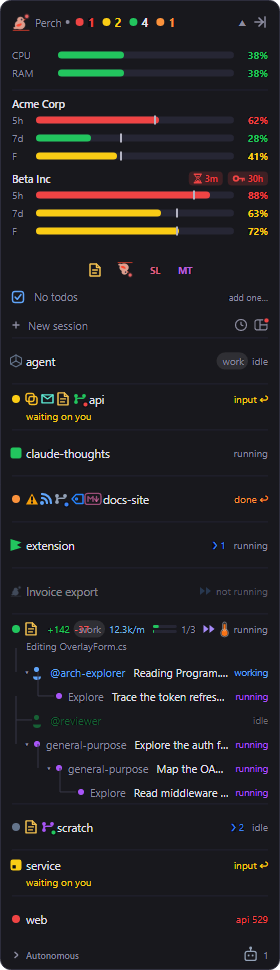
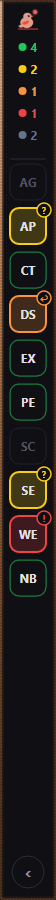
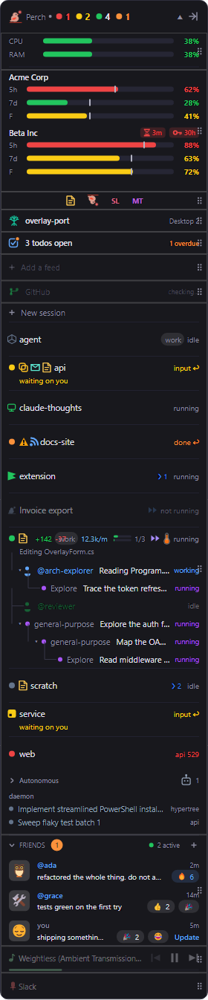

The overlay panel is where Perch tells you a session needs you. It sits on top of your other windows, lists
every Claude Code session it can see, and marks each one so you can tell at a glance which to go back to.

## Read a session's state

Every session is in one of four states, shown by the coloured dot on the left of its row and the word on the
right:

| State | Row shows | What it means |
| --- | --- | --- |
| Running | `running` | Claude is working. The line under the name says what it's doing and how long it's been at it. |
| Idle | `idle` | The session is open but not doing anything. |
| Waiting on you | `input ↩` | The session stopped on a permission prompt or a question. The line under the name reads "waiting on you" with a timer. |
| Done | `done ↩` | The session finished and you haven't looked at it yet. |

A session whose last request to the API failed shows `api 529` (or `api error` when the code isn't known) in
red instead of `done`, so a failed run never passes for a finished one.

When a session finishes, starts waiting or hits an API error, the panel flashes a border around itself for a
few seconds. If the panel is collapsed, it expands so you can see the row. See
[Alerts & notifications](/perch/features/alerts/) for the toasts and sounds that go with it.

Click a row to go back to that session. See [Jump back to a session](/perch/features/jump-back/).

## The header

The header shows a count for each state that has sessions in it, for example red for API errors, yellow for
waiting, green for running and orange for done. The idle count only appears when nothing else is going on.
With no sessions at all it reads "no sessions".

- **Click the header** to collapse or expand the panel. A collapsed panel keeps only the header.
- **Drag the header** to move the panel.
- **The side arrow** at the right of the header shrinks the panel to the dense strip (see below).

The panel stays open when the last session ends, because the sections below the header are still useful with
no sessions running.

## What a session row shows

Each row has the session's name, its state, and a second line while it's running (the current tool or task,
and a timer) or waiting on you (how long it has waited).

Running sub-agents appear as indented rows under their session, nested to show which agent started which.
Agent Teams teammates appear the same way, marked `working` or `idle`.

Around the name, Perch can show small glyphs. Most can be turned off, and some are off until you turn them on:

| Glyph | What it tells you |
| --- | --- |
| Permission-mode badge | The session is in Plan, Accept edits, Auto or Bypass mode. Dimmed while the session is idle. |
| `n/m` task count | Progress through the session's task checklist. Turns green when every task is done. |
| `❯ 2` | Background shells or monitors still running, so an idle session with a dev server running doesn't look finished. |
| Thermometer | How full the session's context window is. It appears at the first threshold and warms from yellow to orange to red. Hover it for the numbers. |
| Waiting timer | How long a waiting session has waited. It warms from yellow to red over the "Waiting timer red threshold". |
| `12.3k/m` | Live burn rate in tokens per minute, while the session is running. |
| `+142 -37` | Lines added and removed in the session's folder, from `git diff`. |
| Amber warning | The session looks stuck: several tool calls failing in a row, or the same action repeating and failing. |
| Note | The session's folder has a pinned note. Hover it to read the note. |
| Artifact | The session published one or more web artifacts. Click to pick one to open. |
| Markdown | The session wrote or edited a `.md` file. Click to open it in Perch's viewer. |
| Envelope | Phone push is on for this session (see [Alerts & notifications](/perch/features/alerts/)). |
| CPU/RAM mini-bar | The session's own CPU and memory use. Hover for the numbers. |
| Pull request, Jira ticket | The session's branch has a GitHub PR or a Jira key. See [Panel extras](/perch/features/panel-extras/). |
| Config label | Which Claude config directory the session belongs to, shown only when you watch more than one. See [Accounts](/perch/features/accounts/). |

A session that runs in an IDE or in Claude Desktop shows that app's icon in place of the status dot, coloured
to match its state. A session Perch is running in its own window shows the Perch mark.

:::note[Windows only]
IDE icons need Perch to detect the IDE that hosts a session, which currently works on Windows only.
:::

### Other rows

- **Autonomous**: sessions started by scripts or the SDK, rather than by a person, are grouped under a
  collapsible "Autonomous" heading at the bottom of the list. Click the heading to expand or collapse it.
- **Not running**: a Perch-run session whose process has gone (for example after Perch closed) keeps a faded
  row marked `not running`. Click it to open it again.
- **Daemon workers**: headless worker sessions from Claude Code's background daemon are listed in their own
  section under the rows.

## Right-click menus

**Right-click a session row** for actions on that session. Which items appear depends on the session:

- **View history**, and **Show QR code** for a remote-controlled session.
- **Mark as read** on a done session, to clear it without going to it. **Mark as unread** on an idle one, to
  flag it to come back to.
- **View git history…** and **Open in GitKraken** (when GitKraken is installed) for a session in a git repo.
- **Add note…**, **Edit note…** and **Clear note**, when Pinned notes are on.
- **Enable external notifications** or **Disable external notifications**, when phone push is set up.
- **Markdown files…** and **Todos…**.
- **Terminate session…**.
- **Copy session ID** and **Open transcript in VS Code**.

**Right-click the header** for the panel itself:

- Show or hide system metrics and usage.
- **Dock to screen edge** or **Switch to floating overlay** (Windows only).
- **Set initial placements…** opens the placement editor.
- **Reset size**, after you've resized the panel.
- **Quiet mode**, see [Alerts & notifications](/perch/features/alerts/#quiet-mode).
- **Exit Perch**.

Right-clicking the system metrics or usage strip offers to hide just that strip.

## Dense strip

The dense strip is a slim bar that hugs the left or right edge of a screen. It shows the Perch icon and one
dot and count per state that has sessions. Hover the strip to open the full panel; it closes again shortly
after the pointer leaves.

- Enter it with the side arrow in the panel header, or with the **Alt+Shift+W** shortcut (the default). Use
  the same arrow or shortcut to leave it.
- Drag the strip up or down the edge. Drag it towards another edge, on any monitor, and drop it on the
  highlighted lane to move it there.
- When a session changes state, the strip either opens the full panel or floats a small speech bubble off the
  logo. Choose with the "Dense strip status changes" setting (**Expand** or **Bubble**).

## Docked mode

:::note[Windows only]
Docked mode reserves a strip of the screen through Windows, so it isn't offered on macOS.
:::

In Docked mode the panel becomes a full-height column on the left or right edge of a monitor. Windows treats
that space as reserved, so a maximised window stops at the column instead of covering it.

- Switch between **Floating** and **Docked** with the "Overlay mode" setting, or from the header's
  right-click menu.
- Press **Ctrl+Shift+W** (the default shortcut), or click the round tab at the bottom of the column, to collapse it to a narrow strip
  or expand it again.
- The collapsed column shows the state counts and a tile per session, with the session's initials. Tiles keep
  a fixed order, so you learn where each project sits. A session that needs you gets a coloured wash and a
  badge (`↩` done, `?` waiting, `!` API error). Click a tile to go to the session. When the tiles don't fit,
  the last one becomes `+N`; click it to expand the column.
- Drag the header to move the column to another edge or monitor.
- When a session needs you, a collapsed column does not expand on its own, because that would push every
  maximised window aside. The tiles show it instead.

## Place and resize the panel

**Placement editor.** Choose **Set initial placements…** from the header's right-click menu, or find "Initial
overlay placement" in Settings. A dimmed full-screen editor shows a real-size preview. Pick **Overlay**,
**Dense** or **Docked** (Windows only), drag the preview where you want it, and drag its side edge to set the
width. **Done** saves, **Reset to defaults** puts the current layout back, and **Cancel** discards.

Placement is saved relative to the nearest screen corner, so it survives a resolution change.

**Resize.** Drag either side edge of the floating panel, or the inner edge of the docked column, to make it
wider. The panel can't go narrower than its default width. A drag like this isn't saved: it lasts until
Perch restarts, and **Reset size** on the header menu undoes it. To keep a width, set it in the placement
editor.

Dragging the panel to a new spot isn't saved either. Perch does remember where you left it while it runs, so
plugging in or removing a monitor puts it back the same distance from the corner.

## Reorder the sections

The panel's sections (system metrics, Claude usage, quick links, Hypertree, to-dos, GitHub, feeds, sessions,
friends, media and call) can go in any order. The header always stays at the top.

1. Open **Settings** from the tray menu and go to **Features**.
2. Under the live preview on the right, turn on **Rearrange**. Every section shows, and the ones you've turned
   off are dimmed.
3. Drag a section to its new place. The live panel follows straight away.

**Reset arrangement** appears once the order differs from the default and puts it back.

## Optional sections

The panel can carry more than sessions. Each of these is off or on from Settings, and covered on its own page:

- **System metrics and Claude usage**: see [Usage & limits](/perch/features/usage-limits/).
- **Quick links, to-dos, GitHub alerts, Hypertree, feeds, now-playing media and microphone**: see
  [Panel extras](/perch/features/panel-extras/).
- **Friends**: see [Social](/perch/features/social/).
- **+ New session**, **Roost** and **Recent**: see [Session window](/perch/features/session-window/) and
  [Roost](/perch/features/roost/).

## Settings

Open **Settings** from the tray menu. Type a setting's name into **Search** to find it, or browse **Features**,
where a live preview shows the effect as you change it.

| Setting | What it does |
| --- | --- |
| Permission-mode badges | Shows the Plan, Accept edits, Auto or Bypass badge on a session. On by default. |
| Task progress | Shows the `n/m` task count. On by default. |
| Background tasks | Shows the count of running background shells and monitors. On by default. |
| Context pressure | Shows the context thermometer. On by default. |
| Context pressure thresholds | Sets the yellow, orange and red bands (50%, 65% and 80% by default). |
| Always show context pressure | Shows the thermometer in green below the first threshold, instead of hiding it. |
| Pinned notes | Shows the note glyph on a row. Off by default. |
| Burn rate | Shows tokens per minute on a running session. Off by default. |
| Waiting timer | Shows how long a waiting session has waited. On by default. |
| Waiting timer red threshold | Minutes until the waiting timer is fully red (10 by default). |
| Artifacts | Shows the artifact glyph. On by default. |
| Markdown glyph | Shows the Markdown glyph. Off by default. **Markdown files…** stays on the right-click menu either way. |
| IDE status icons | Shows the host app's icon in place of the status dot. On by default. |
| Git line churn | Shows lines added and removed. Off by default, and no `git` runs while it's off. |
| Stuck detection | Shows the amber warning on a stuck session. On by default. |
| Detect error streaks | Counts several failing tool calls in a row as stuck. |
| Detect failing loops | Counts the same failing action repeated as stuck. |
| Hide inactive team members | Hides idle teammates, showing only the ones working. |
| Per-session metrics | Shows a CPU/RAM mini-bar on each row. Off by default. |
| Daemon workers | Lists the background daemon's worker sessions. On by default. |
| Overlay mode | Floating or Docked. Windows only. |
| Initial overlay placement | Opens the placement editor. |
| Dense strip status changes | Expand the panel, or show a bubble, when a session changes state in the dense strip. |
| Section arrangement | Points you to the Rearrange mode in the Features preview. |

The keyboard shortcuts for the dense strip and the docked column can be changed on the **Shortcuts** page.

## Related

- [Alerts & notifications](/perch/features/alerts/)
- [Usage & limits](/perch/features/usage-limits/)
- [Jump back to a session](/perch/features/jump-back/)
- [Panel extras](/perch/features/panel-extras/)
- [Appearance](/perch/features/appearance/)
