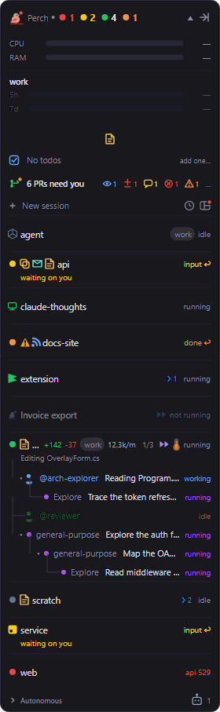
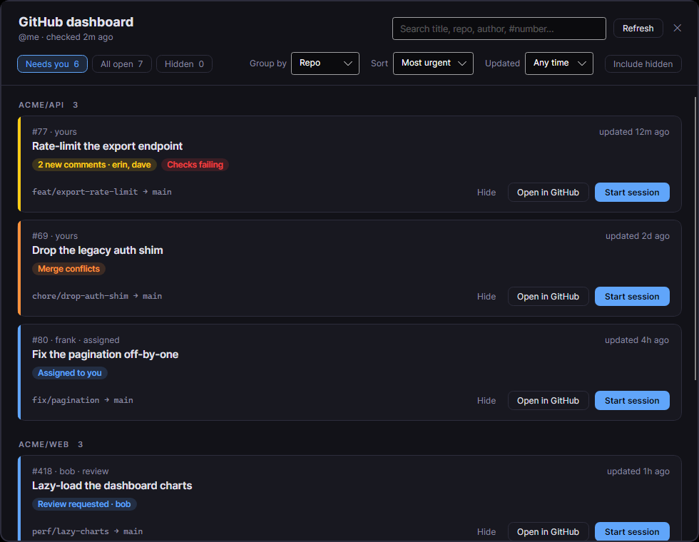
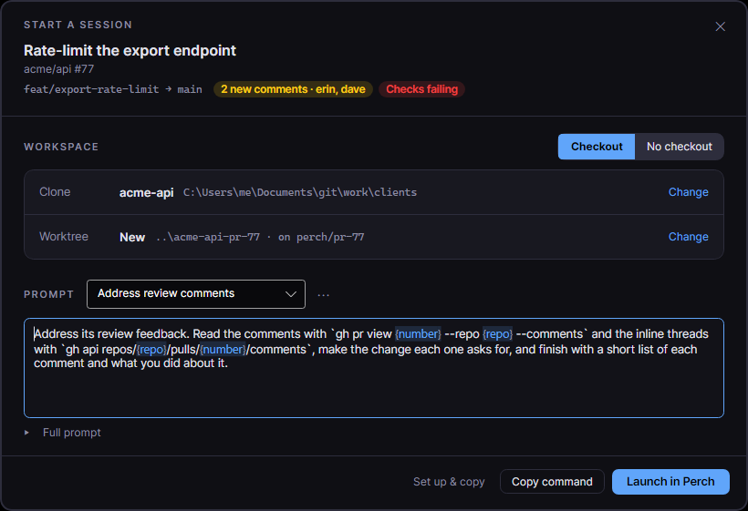

Besides your sessions, the overlay panel can carry a few optional sections: app launchers, your own to-dos,
the GitHub pull requests waiting on you, feeds you follow, and what is playing or holding your microphone. Most
are off until you turn them on.

You choose the order of these sections by dragging them in the Settings live preview. See
[Overlay panel](/perch/features/overlay-panel/).

## Quick links

Quick links are a row of app icons on the panel. Click one to open that app, or to bring it to the front if it
is already running. The row also always holds a note button that opens your scratch pad.

To set them up, open **Settings → Quick Links**:

- Click **Add quick link…** and name the link after the app. If an installed app matches that name, Perch finds
  its icon and the program path is optional. Otherwise choose the program with **Browse…**.
- Click a preset button (**+ GitKraken**, **+ Slack**, **+ Microsoft Teams**, **+ Outlook**) to add one of the
  apps Perch knows how to find.
- Use a link's toggle to hide it without removing it, or **Edit** and **Remove** to change it.

:::note
The presets look for the usual Windows install locations of those apps. On any platform you can still add a
link by choosing the program yourself.
:::

## To-dos

To-dos are your own reminders: a title, optional notes and an optional due time. Turn on **Todos** to get a
one-line row on the panel showing how many are open and how many are overdue, or when the next one is due.
Hover the row to see the next few items. Click it to open the Todos window.

You can also open the Todos window from the tray menu (**Todos…**) or a session's right-click menu.

In the Todos window:

- Type in **What needs doing?** and click **Add todo**. Pick a due time with the date button: **Today**,
  **Tomorrow**, **Next week**, a calendar date, and a time.
- The list is grouped into **Overdue**, **Upcoming** and **No date**. Tick **Show completed** to see finished
  items.
- Select a to-do to read its notes on the right, then **Complete**, **Edit** or **Delete** it.

Turn on **Todo reminders** to get a desktop notification when a to-do falls due. Each item reminds you once.

## GitHub alerts

GitHub alerts add one line to the panel saying which of your open pull requests need you: reviews requested,
new comments, failing checks, merge conflicts, ready to merge, or assigned to you. Small symbols show the count
of each kind. Hover the line for a summary, and click it to open the GitHub dashboard.

### Connect GitHub

GitHub alerts use the GitHub CLI, `gh`, and your existing login. Install `gh`, run `gh auth login` once, then
turn on **GitHub alerts**. Perch never handles a GitHub token itself. If a check fails, the line and its
tooltip say so.

### The GitHub dashboard

Each pull request is a card with its repository, number, author, age, title, the reasons it needs you and its
branches. Three tabs switch what you see:

- **Needs you**: the default.
- **All open**: every open pull request that involves you.
- **Hidden**: the ones you have hidden, each with **Unhide**.

Use the toolbar to **Group by** repo, reason, role or none, to **Sort** by most urgent, recently updated or
oldest first, and to limit to pull requests **Updated** within a time window. The time window also trims the
panel line. Search with the box at the top (Ctrl+F) by title, repo, author or `#number`.

Opening a pull request marks it as seen, so one that only had new comments drops out of **Needs you**. Reviews
you owe stay.

Click **Hide** to put a pull request out of view until something changes on it, such as new comments or
reviews, a review decision, or checks starting or stopping. Turn on **Include hidden** to show hidden ones in
the other tabs too.

### Start a session from a pull request

Click **Start session** on a card to open a Claude Code session on that pull request.

- **Workspace**: choose **Checkout** to work in a copy of the repo, or **No checkout** to have Claude read the
  pull request with `gh` from an empty scratch folder.
- **Clone**: the local clone Perch found among your projects. Click **Change** to pick another. If there is no
  clone, Perch makes a fresh one.
- **Worktree**: **New** makes a worktree for the pull request, **Existing** uses one of the repo's worktrees
  as it is, and **None** uses your checkout as it is. New worktrees go where your other worktrees for that repo
  live. If you change the location, Perch remembers it for the repo.
- **Account**: when you have a choice, the same account rules and guardrails apply as for any new session. See
  [Multiple accounts](/perch/features/accounts/).
- **Prompt**: pick a quick prompt or write your own. Type `{` to insert a pull request detail such as
  `{number}` or `{repo}`. Use the menu beside the picker to save a prompt as your own template. Expand **Full
  prompt** to see what Perch adds: the pull request link, the branch, and rules against pushing or posting.

Then choose how to start:

- **Launch in Perch** (Ctrl+Enter) opens a session window named after the pull request.
- **Copy command** copies a terminal command that does the setup and starts Claude. Perch changes nothing.
- **Set up & copy** makes the folder now, then copies just the command that starts Claude in it.

Perch asks Claude Code's folder-trust question for the final folder before it starts, as it does for any new
session.

## Feeds

Feeds follow Atom and RSS sources, such as release notes, blogs and status pages, as a row of story-style heads
on the panel. A head's ring lights up when its feed has entries you have not seen. Click it to play them, and
scroll back through recent entries.

Manage feeds in **Settings → Feeds**:

- **Add feed…** takes a feed address, or a site's address and finds its feed.
- **Mark all read** and **Check all now** act on every feed.
- **Import OPML…** and **Export OPML…** move your list to and from other feed readers.

A feed you add starts quiet: only what is published after that lights up. Images are off per feed unless you
turn them on. Feed content is shown as plain text, scripts and embedded media are never loaded, and links open
in your browser.

## Hypertree

If you use Hypertree, the virtual-desktop branch manager, turn on **Hypertree** to add a line showing the branch
you are on and its desktop. Click the line to open Hypertree's map. The line only appears while Hypertree's tray
is running.

## Jira tickets

With **Jira ticket** on, a session whose branch name contains a Jira key (for example `SFTY-1234`) shows a
ticket glyph that links to the issue. Set **Jira site** to your Jira sub-domain, and optionally **Jira project
keys** to limit which keys match.

## Now playing and microphone

:::note[Windows only]
The now-playing and microphone sections are not available on macOS yet.
:::

- **Now-playing media** adds a strip with the current track and previous, play/pause and next buttons. It only
  appears while something is playing.
- **Microphone presence** adds a strip naming the app that currently holds your microphone. Click the name to
  jump to that app's window, such as your meeting. It only appears while the microphone is in use. It does not
  try to tell you whether you are muted.

## Service status

**Service status footer** adds a line at the bottom of the panel when status.claude.com reports a problem. Set
how often Perch checks with **Service status poll interval**.

## Settings

| Setting | What it does |
| --- | --- |
| Quick links | The launcher icons on the panel. Edited on the Quick Links page. |
| Upside-down quick links | Rotate the quick-link icons 180 degrees. |
| Todos | A Todo line on the panel counting open and overdue to-dos. Click it to open the list. |
| Todo reminders | A desktop notification when a to-do's due time arrives. |
| GitHub alerts | A panel line for open pull requests that need you, with the GitHub dashboard behind it. Uses the `gh` CLI. |
| GitHub alerts interval | How often, in minutes, to check GitHub for pull requests that need you. |
| Feeds | A row of story-style feed heads on the panel. |
| Feed subscriptions | The Atom and RSS feeds you follow, with OPML import and export. |
| Feeds check interval | How often, in minutes, each feed is checked. |
| Notify on new feed entries | A notification when a feed publishes something new. |
| Hypertree | The Hypertree branch line. |
| Jira ticket | A ticket glyph on sessions whose branch carries a Jira key. |
| Jira site | Your Jira sub-domain that ticket glyphs link into. |
| Jira project keys | Optional comma-separated project keys to match. Blank matches any key. |
| Now-playing media | The media controller strip. Windows only. |
| Microphone presence | Which app currently holds the microphone. Windows only. |
| Service status footer | A footer when status.claude.com reports a problem. |
| Service status poll interval | How often, in minutes, to check status.claude.com. |
| Section arrangement | The order of the panel's sections, set by dragging in the live preview. |

## Related

- [Overlay panel](/perch/features/overlay-panel/)
- [Alerts](/perch/features/alerts/)
- [Multiple accounts](/perch/features/accounts/)
- [Session window](/perch/features/session-window/)
