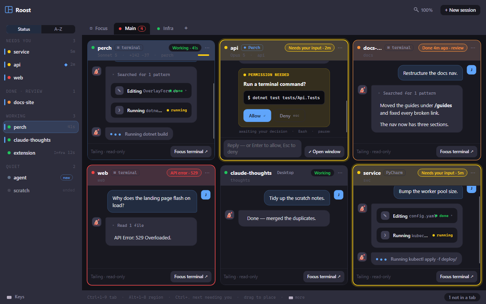
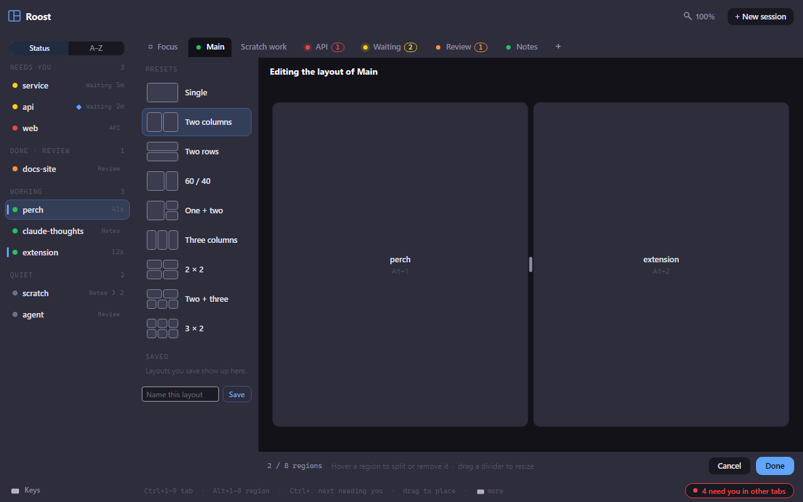
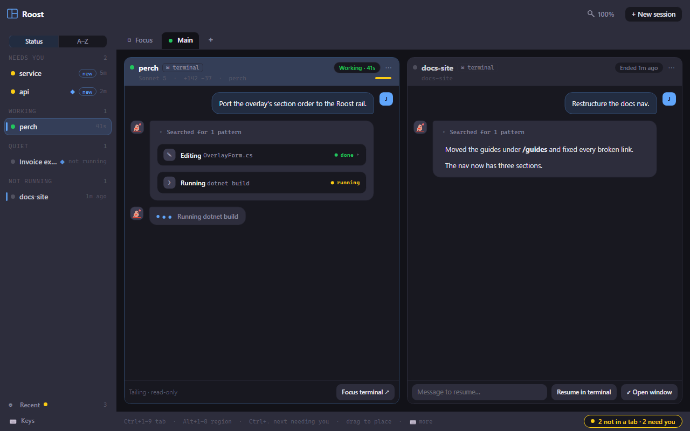
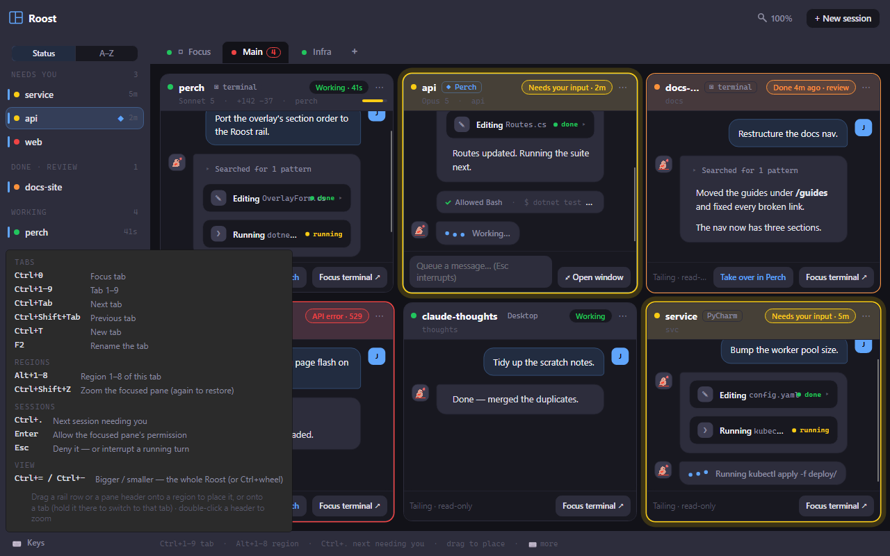

The Roost is one big window that shows every session at once. A rail on the left sorts them by who needs you
most, and the stage on the right shows live panes you can read, answer and jump from. Use it when you run
several sessions and want to see them all without hunting through terminals.

## Open the Roost

- Click the split-panes **Roost** button on the overlay's **+ New session** row. A dot on it means a session
  is waiting for you.
- Choose **Roost…** from the tray menu.
- Press **Alt+Shift+R** from anywhere. You can change this shortcut on the **Keyboard shortcuts** page in
  Settings ("Open the Roost").

The first time you open it, Perch makes a **Main** tab holding up to six of your live sessions.

## Read the status rail

The rail lists every live session. Use the toggle at the top to choose how:

- **Status** groups sessions by what they need from you: **Needs you** (waiting for input, or stopped on an
  API error, longest-waiting first), **Done · Review**, **Working** and **Quiet**. Each heading shows a count.
- **A–Z** lists them all by name.

Each row shows the session's status dot and name, a ◆ for sessions Perch runs, and how long it has been in
its current state. A coloured bar marks sessions in the tab you're looking at; sessions in another tab show
that tab's name; a **new** pill marks one you haven't placed yet. Sessions that ended stay greyed in Quiet
for ten minutes.

Click a row to go to it. If it's in a tab, the Roost switches to that tab. If it's in no tab, it opens in the
Focus tab.

At the foot of the rail:

- **Recent** lists sessions that ended lately, with a dot when one was cut off and you haven't looked. Pick
  one back up, open it in a terminal, or dismiss it.
- **N hidden** lists panes you closed. Click one to reopen it, or choose **Reopen all**.
- **Keys** shows every Roost shortcut.

The bottom bar tells you about sessions you can't see: **N not in a tab** (click to focus the most urgent),
and **N need you in other tabs** (click to go there).

## Work with tabs

Each tab has its own layout of up to eight regions, each holding one session.

- **Focus** is always the first tab. It has a single region and shows whichever session in no tab you last
  clicked. You can't rename, close or re-lay it out.
- **Add a tab** with the **+** at the end of the strip, or **Ctrl+T**. You can have up to 12.
- **Rename a tab** by double-clicking it, pressing **F2**, or right-clicking and choosing **Rename**.
- **Duplicate** a tab's layout (with empty regions) from its right-click menu.
- **Close a tab** with **Close tab** on its right-click menu, or middle-click it. Its sessions go back to the
  rail.
- **Reorder tabs** by dragging one onto another.

Tabs light up when something inside them needs you: the dot takes the colour of the most urgent session, a
count shows how many need you or are done for review, and on tabs you're not looking at the dot pulses when a
session is waiting or has errored.

Your tabs, layouts, hidden panes, rail sort and zoom are saved, so the Roost comes back the way you left it
after a restart.

## Place sessions

- **Drag** a rail row or a pane's header onto a region to put that session there. The session that was there
  swaps into the old spot, or goes back to the rail.
- **Drag onto a tab** to drop the session into that tab without leaving the one you're on. Hold it over the
  tab for a moment to switch to it and carry on dragging.
- **Click an empty region** to pick a session for it: sessions in no tab come first, then ones in other tabs
  (which move here), then **+ New session here**.
- **Esc** cancels a drag.

To give one pane the whole tab, double-click its header, choose **Zoom / restore** from its **⋯** menu, or
press **Ctrl+Shift+Z**. Do it again (or press **Esc**) to restore the layout.

## Paint your own layouts

Right-click a tab and choose **Edit layout…** to open the painter.

- Pick a starting shape from **Presets**: Single, Two columns, Two rows, 60 / 40, One + two, Three columns,
  2 × 2, Two + three or 3 × 2.
- Hover a region to **split** it side by side or top and bottom, or **remove** it (a neighbour grows into its
  space, and its session goes back to the rail).
- Drag a divider to resize. Dividers snap to a grid.
- To keep a layout, type a name in **Name this layout** and click **Save**. Saved layouts appear under
  **Saved**; right-click one to rename or delete it. Typing an existing name replaces it.
- Click **Done** (or press **Enter**) to use the layout, or **Cancel** (or **Esc**) to put it back.

Sessions follow their regions into the new layout.

## Answer from a pane

Each pane shows the session's conversation, its status, model, line churn, folder and a context bar. What you
can do depends on the session.

**Sessions Perch runs** (marked **◆ Perch**) have a reply box at the bottom of the pane:

- Type and press **Enter** to send. **Shift+Enter** adds a new line.
- While a turn is running, what you type is queued. **Esc** interrupts the turn.
- When Claude asks for permission, press **Enter** in an empty reply box to allow it, or **Esc** to deny it.
  Enter and Esc also work on the pane you last clicked into, without focusing the reply box.
- **Open window** opens the session in its full [session window](/perch/features/session-window/).

**Terminal and IDE sessions** are read-only in the Roost (**Tailing · read-only**). The pane follows the
transcript and shows the most recent part of it; click **Load earlier** for more.

- **Focus terminal** takes you to the session's window, as a click on its overlay row does.
- **Take over in Perch** stops the session in its terminal and continues the same conversation in Perch. It
  asks first, and only appears for terminal sessions Perch doesn't already run.

A pane's **⋯** menu also has **Remove from tab** (back to the rail), **Copy resume command** (copies
`claude --resume <id>`) and **Close pane**, which hides it under **N hidden**.

## Sessions that aren't running

When Perch closes (an exit, an update, a restart), the sessions it runs wait for you, marked "not running".

If a tab holds one, it appears in the rail under **Not running**, and its pane shows how it stopped (for
example "Interrupted" or "Before shutdown"). Type a message in its pane to resume it, or use
**Resume in terminal** or **Open window**. Its **⋯** menu has **End session** to remove it for good.

Sessions that ended and aren't in a tab are in the **Recent** list at the foot of the rail.

## Less noise while you watch

- Perch doesn't send a notification for a session whose pane you can already see in the active Roost. If you
  look away while the session is still waiting, the notification arrives then.
- When a session newly needs you and the Roost isn't the active window, its taskbar button flashes (on macOS,
  the Dock icon bounces once).
- Pulsing rings and tab dots hold still if you've turned off animations in Windows.

## Zoom

Make the whole Roost bigger or smaller with **Ctrl+=** and **Ctrl+−**, or **Ctrl+wheel**. The magnifier
button in the title bar shows the current level; click it to pick a level from 75% to 200%, or
**Reset to 100%**.

## Keyboard shortcuts

| Shortcut | What it does |
| --- | --- |
| Alt+Shift+R | Open the Roost (from anywhere) |
| Ctrl+0 | Focus tab |
| Ctrl+1 to Ctrl+9 | Tab 1 to 9 |
| Ctrl+Tab | Next tab |
| Ctrl+Shift+Tab | Previous tab |
| Ctrl+T | New tab |
| F2 | Rename the tab |
| Alt+1 to Alt+8 | Region 1 to 8 of this tab |
| Ctrl+Shift+Z | Zoom the focused pane (again to restore) |
| Ctrl+. | Next session needing you |
| Enter | Allow the focused pane's permission |
| Esc | Deny it, or interrupt a running turn |
| Ctrl+= / Ctrl+− | Bigger / smaller (or Ctrl+wheel) |

**Ctrl+.** cycles through sessions that need you, then ones done for review, in rail order. Click the hint line
at the bottom of the Roost, or **Keys** in the rail, to see the full list.

## Settings

| Setting | What it does |
| --- | --- |
| Roost button | Show the split-panes button on the overlay's **+ New session** row that opens the Roost. The tray menu and Alt+Shift+R work either way. |
| Recent sessions | Show the Recent button beside the Roost button on the overlay, listing sessions that ended lately. |

## Related

- [The session window](/perch/features/session-window/)
- [Jumping back in](/perch/features/jump-back/)
- [The overlay panel](/perch/features/overlay-panel/)
- [Alerts and notifications](/perch/features/alerts/)
