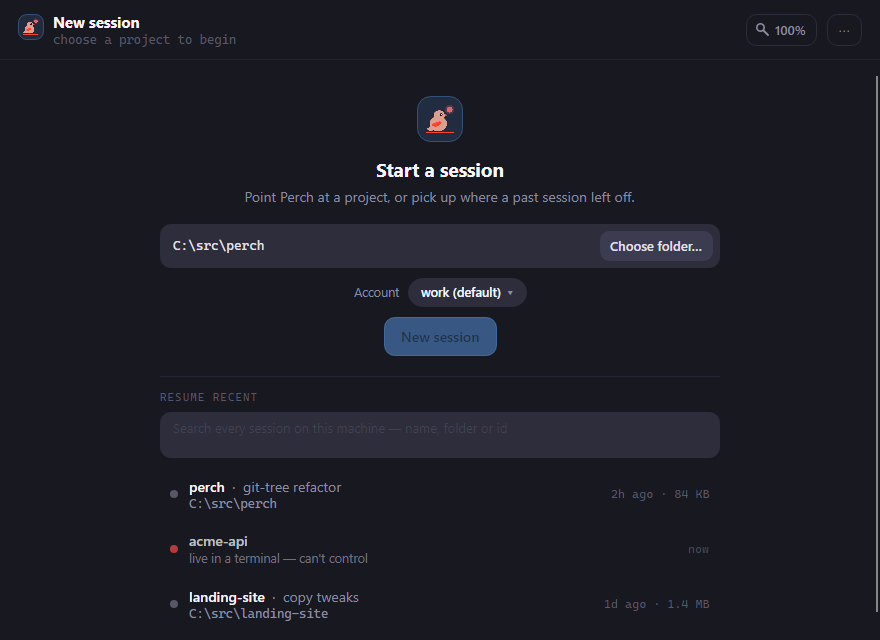
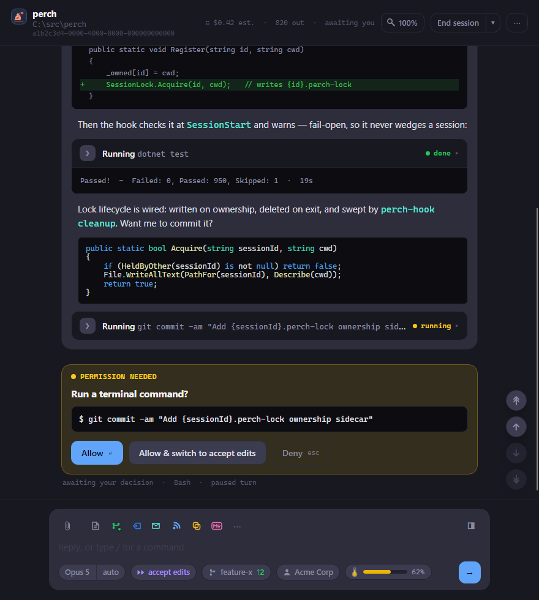
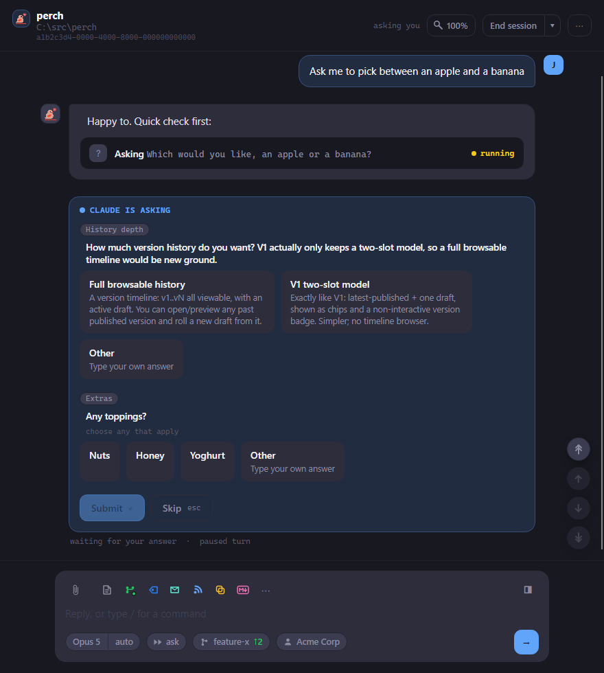
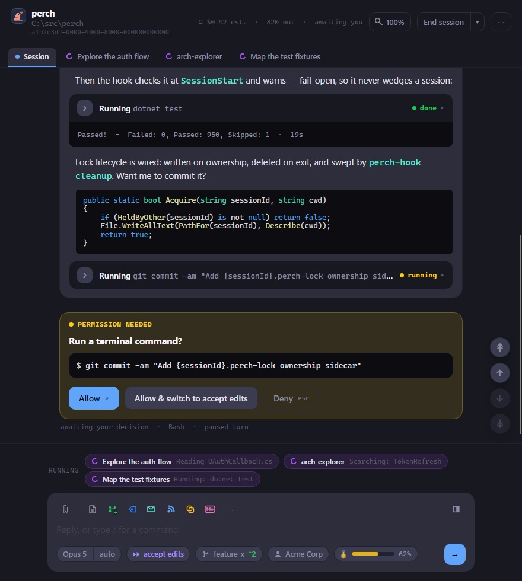

Perch can run Claude Code sessions itself, in its own window. You get the same Claude Code, with permission
prompts as cards you click, a changed-files panel beside the conversation, and sub-agents you can watch live.
When a session Perch runs needs you, clicking its row brings this window straight back.

:::note
The session window is still marked experimental. It does a lot, and it's rough in places.
:::

## Start a session

Open a new session window in any of these ways:

- Click **+ New session** on the overlay.
- Choose **New session…** from the tray menu.
- Run `perch` in a terminal to start one in the current folder. See
  [The `perch` command](/perch/features/jump-back/#the-perch-command).
- From an open session, choose **New session in another folder…** on the **⋯** menu.

1. Pick a folder. Click the folder box to see your recent project folders, or type to filter them. **Tab**
   completes the closest match, and **Choose folder…** opens a folder picker.
2. If you have more than one Claude account signed in, pick one under **Account**. If an
   [account guardrail](/perch/features/accounts/) allows only one account for this folder, the picker is
   locked with a padlock.
3. Click **New session**, or press **Enter**.

If you haven't used the folder with Claude Code before, Perch asks **Do you trust the files in this folder?**,
the same check Claude Code runs. Your answer is shared with Claude Code.

### Resume a past session

Under **Resume recent**, the same screen lists your recent sessions. The search box finds any session on this
machine by name, folder or id. Click one to resume it. Right-click to copy its session id.

A session that's still running in a terminal is marked as live in a terminal. Perch can't resume
it while it runs: close it there first, or move it into Perch (see
[Take over a terminal session](#take-over-a-terminal-session)).

A resumed session shows its conversation straight away. Claude itself starts when you send your first
message. A short note above the composer estimates what resuming will cost: the context to reload, whether the
cache is still warm, and the share of your 5-hour limit.

## Write a prompt

Type in the composer and press **Enter** to send. **Shift+Enter**, or `\` then **Enter**, adds a new line.

- **Mention files** by typing `@`. Perch lists matching files in the project (respecting `.gitignore`); pick
  one with the arrow keys and **Tab** or **Enter**.
- **Recall earlier prompts** with **↑** at the start of the composer. **↓** moves forward again and gets your
  draft back.
- **Attach images** by pasting (**Ctrl+V**), dragging them in, or clicking the paperclip. Each image leaves an
  `[Image #N]` marker in your text. Delete the marker to remove the image, or remove the image to delete the
  marker. Images over 5 MB aren't attached.
- **Drag in other files** to insert their paths.

### Slash commands

Type `/` at the start of a message to open the command palette. Use the arrow keys to choose, **Tab** to
complete and **Enter** to run. Skills also autocomplete partway through a message.

Most commands go to Claude Code as normal (for example `/clear`, `/compact`, `/rename`, `/context`). A few
open Perch's own panels instead:

| Command | What happens |
| --- | --- |
| `/model`, `/effort` | Opens the model or effort menu. |
| `/resume` | Opens a search of this project's sessions. **Enter** resumes in this window, **Shift+Enter** in a new one. |
| `/usage` | Opens your plan's usage bars, with reset times. |
| `/mcp` | Opens the MCP server status window. |
| `/autocompact` | Sets whether and when the conversation compacts automatically. |
| `/rc` | Turns remote control on or off. |
| `/login`, `/logout` | Opens a terminal running Claude Code's sign-in. |
| `/exit` | Ends the session and closes the window, without asking. |

### The composer's pills and toolbar

Along the bottom of the composer:

- **Model** and **effort**: click to change mid-session.
- **Permission mode**: ask, auto, plan mode, accept edits or bypass permissions. Click to change.
- **Branch**: the current git branch, with how far ahead (↑) or behind (↓) its upstream it is.
- **Account**: which account the session runs under (only when you have more than one).
- **Context bar**: how full the context window is. Hover for the numbers.

Above the text box are the paperclip, the same glyphs the session's overlay row shows (pull request, Jira
ticket, notifications, remote control and so on), and a **⋯** menu to turn on remote control, external
notifications, or open the git history.

## Answer Claude

When Claude needs a decision, the turn pauses and a card appears in the conversation.

- **Permission cards** ("Permission needed") say what Claude wants to do: run a command, edit a file, fetch a
  page. Click **Allow** or **Deny**. When Claude Code suggests one, a third button allows and switches the
  session's permission mode at the same time. With the composer empty, **Enter** allows and **Esc** denies.
- **Plan cards** show Claude's plan. Click **Approve** (or approve and switch mode), or
  **Keep planning**.
- **Question cards** ("Claude is asking") offer answers as buttons. Pick one, or choose **Other** to type your
  own. Questions that allow several answers say "choose any that apply". Click **Submit**, or **Skip** (**Esc**).

After you answer, the card shrinks to a one-line receipt such as "Allowed" or "Answered". A prompt answered
from your phone over remote control shows "Answered remotely".

If a session needs a decision while its window is hidden (and it isn't on screen in the Roost), Perch shows a
desktop notification saying a session needs you.

## Read the conversation

- Replies render as Markdown while they stream in. Claude's thinking shows as a collapsible "Thought" line.
- **Tool calls** are cards. Edits and writes show a diff. Click a card's header to expand it and see its
  output.
- Consecutive Read, Grep and Glob calls **fold** into one line, such as "Searched for 3 patterns, read 1 file".
  Click it to see each call. The line turns red if any of them failed.
- When you scroll through a long open card, its **header stays pinned** at the top. Click the pinned header to
  fold the card, or use its **↑** / **↓** buttons to jump to the card's start or past its end.
- **Copy** a whole message with the copy button that appears when you hover it. Or drag-select across
  paragraphs, lists, code and tables: **Ctrl+C** copies the Markdown, and right-click offers
  **Copy as plain text**.
- **File paths** in replies are links. **Ctrl+click** opens one: Markdown files in Perch's viewer, everything
  else in VS Code at the right line. Right-click a path for more: view diff, reveal in Explorer (Finder on
  macOS), open in VS Code, copy path, open `.html` in a browser, or **Publish as artifact…**.
- The jump buttons on the right go to the start, the previous or next prompt, or the latest reply.
- **Ctrl+F** opens the find bar. **Enter** and **Shift+Enter** step through matches.

To stop Claude mid-turn, press **Esc**, click **Interrupt**, or press **Ctrl+C** with nothing selected.
While a turn runs you can keep typing: what you send is queued.

## Watch sub-agents and background tasks

When Claude starts sub-agents, each one gets a **tab** next to **Session** at the top of the window. Click a
tab to watch that agent's log live. Sub-agent tabs are read-only, since sub-agents take their instructions
from the session; click **Back to session** or press **Esc** to return. When the agent finishes, the window
returns to the session on its own. A permission prompt brings you back too.

The **Running** row above the composer shows a chip for each sub-agent and background task (shells and
monitors) still working. Click a chip to see its output. A stop button on a background task's chip stops it.

## Review changed files

Click the panel button at the top right of the composer to open **Changed files**: every file the project's
git diff shows, with its status and lines added and removed. Click a file to open its diff in the git history
window. The panel refreshes after each tool call, or click **Refresh**.

## Remote control

Type `/rc`, or choose **Turn on remote control** on the composer's **⋯** menu, so you can carry on
the session from your phone or claude.ai. Type `/rc` again to turn it off.

To connect your phone, open the remote control glyph's menu and choose **Show QR code**. The code opens on
the same monitor as the session window. When Claude is waiting on an answer only your phone can give, the
session shows "awaiting remote".

## Zoom

Make the window's text bigger or smaller with **Ctrl+=** and **Ctrl+−**, or **Ctrl+wheel**. **Ctrl+0**
resets it. The magnifier button in the title bar shows the current level; click it to pick one from 75% to
200%. All session windows share the same zoom.

## Close, end or restart

- **Closing the window** (×) only hides it. The session keeps running and stays on the overlay. Click its row
  to bring the window back.
- **End session** stops Claude and closes the window. Perch asks first.
- **Restart session**, in the **▾** beside **End session**, restarts the same conversation in a fresh Claude
  process. Perch asks first only if something is in progress.
- **Resume** appears in the title bar once a session has ended.

When a session's sign-in is about to expire, a banner above the composer warns you. If restarting will pick up
a fresh sign-in, the banner has a **Restart** button.

### When Perch exits

If you exit or update Perch, its sessions aren't lost. They stay on the overlay and in the Roost, marked
"not running". Reply to one to pick it up again with the same model and mode. Only **End session** removes
them. If a session is mid-turn, Perch asks before exiting.

### The ⋯ menu

The **⋯** menu in the title bar has:

- **Hand back to a terminal**
- **Copy resume command** (copies `claude --resume <id>`)
- **Open project folder in Explorer** (Finder on macOS)
- **Open project folder in a terminal**
- **New session in another folder…**

Click the session id under the title to copy it.

## Take over a terminal session

To move a session from a terminal into Perch, right-click its overlay row and choose
**Elevate to Perch (PoC)…**, or use **Take over in Perch** on its pane in [the Roost](/perch/features/roost/).
Perch asks first, stops the terminal's Claude process and resumes the same conversation in a session window.

To read a session without taking it over, open it from **View history** on its row. History uses the same
view as the session window, read-only. See [History and search](/perch/features/history-search/).

## Keyboard shortcuts

| Shortcut | What it does |
| --- | --- |
| Enter | Send. With the composer empty, allow a pending permission. |
| Shift+Enter, or `\` then Enter | New line |
| ↑ / ↓ | Earlier and later prompts |
| Tab | Complete a slash command, `@` mention or folder |
| Esc | Close the open popup or bar; otherwise deny a pending permission, or interrupt the turn |
| Ctrl+C | Copy the selection, or interrupt if nothing is selected |
| Ctrl+V | Paste text or an image |
| Ctrl+F | Find in the conversation |
| Ctrl+= / Ctrl+− / Ctrl+0 | Zoom in, out, reset (or Ctrl+wheel) |

## Settings

| Setting | What it does |
| --- | --- |
| Recent sessions | Show the Recent button on the overlay, listing sessions that ended lately to pick back up. |
| Roost button | Show the button that opens the Roost, where you can answer Perch sessions from a pane. |

## Related

- [Jumping back in](/perch/features/jump-back/)
- [The Roost](/perch/features/roost/)
- [History and search](/perch/features/history-search/)
- [Accounts](/perch/features/accounts/)
- [Usage and limits](/perch/features/usage-limits/)
