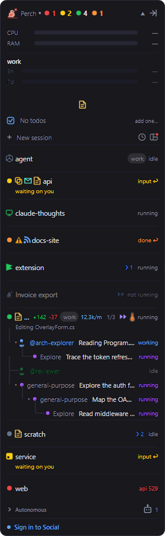
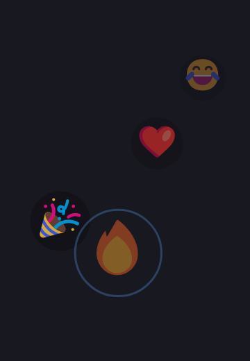

The friends feed is a small, opt-in corner of the overlay for friends who also run Claude Code with Perch. You
post a short status, and see your friends' latest statuses, moods and reactions under your sessions.

:::caution[This feature sends data to a server]
The friends feed is the only part of Perch that stores data on a server, and it is **off by default**. With
**Social feed** off, Perch makes no Social network calls at all. Read the [privacy policy](/perch/privacy/)
before you turn it on: it lists exactly what is stored, who can see it and how to delete it.
:::

## Turn it on and sign in

1. Turn on **Social feed** (search for it in Settings, or open **Settings → Social**).
2. A **Sign in to Social** row appears at the bottom of the overlay. Click it, or click **Sign in with GitHub**
   on the Social settings page. Your browser opens to sign in with GitHub.
3. Pick a handle your friends will recognise: 3 to 20 characters of `a` to `z`, `0` to `9` or `_`.

GitHub has no account picker, so a normal sign-in uses whichever GitHub account your browser is logged into. To
use a different one, click **Sign in with a different account**, which opens a private browser window so GitHub
asks.

You can change your handle later with **Change handle…**. Your friends and status stay; only the name changes.

## Post a status

Right-click the friends region and choose **Post a status…**, click the "what are you working on?" row, or use
**Post a status…** on the Social settings page.

- Type up to 280 characters.
- Click the mood button to pick an emoji for your mood.
- **Post** (Ctrl+Enter) shares it. **Esc** cancels.

Only your current status is kept. Posting a new one replaces the old one.

## Add friends

Friendships are mutual, and there is no directory to browse. You add people by their exact handle.

Open **Friends…** from the friends region's right-click menu, the **+** on the region's header, or the Social
settings page. Then:

- Enter a handle under **Add a friend** and click **Send request**.
- Under **Requests**, **Accept** or **Decline** requests sent to you.
- Under **Friends**, each friend has **Report**, **Block** and **Remove**. A request you sent shows **Cancel**
  instead of **Remove**.

**Remove** ends the friendship quietly: they are not told, and either of you can add the other again later.
**Block** takes their posts out of your feed and lists them under **Blocked**, where **Unblock** undoes it.
Blocks are private to you. **Report** files a report and blocks them in one step.

## The friends region

The region sits on the overlay with a collapsible header. Expanded, it shows one row per friend with their mood,
`@handle`, latest status and how long ago they posted, plus the reactions on that status. Your own status row
sits there too, with the reactions friends have left on it.

- A dot on the **Friends** header means a status you have not seen yet.
- A friend's row glows briefly when they post something new.
- Right-click a friend's row and choose **Dismiss status** to hide that status until they post again.
- When you have more friends than fit, the rest fold into a "+N more" line. Most recent posts come first.

Statuses drop off once they are older than the **Keep statuses for** window on the Social settings page (from
12 hours to 1 week; 2 days by default).

## React to a status

Right-click a friend's status and choose **React to @handle…**, or hover their row and click the **+** beside
their reactions. Pick any
emoji from the picker, or search for one. You get one reaction per status. When several people react, the
reactions fold into a count with the full tally on hover.

With **Show large reactions** on, a friend's reaction to your status floats up your screen as a big emoji bubble.
Click it to pop it.

## Notifications and quiet time

- **Notify when a friend posts** pops a desktop notification when a friend posts a status.
- **Close friends in Do Not Disturb** collapses the friends region and holds off those notifications while
  Windows Do Not Disturb is on. The region doesn't reopen on a new post.
- **Quiet mode** silences the fun and social features for a while. Right-click the overlay header, choose
  **Quiet mode**, and pick **For 30 minutes**, **For 1 hour**, **For 2 hours** or **Until tomorrow morning**.
  While it is on, the friends feed is off: no region, no notifications and no Social network calls. Everything
  comes back when the time is up.

## Sign out, export or delete your data

Everything about your account is on **Settings → Social**:

- **Sign out** signs you out on this machine.
- **Download my data (JSON)…** saves everything Perch Social stores for you (your profile, status, reactions,
  friends and blocks) to a JSON file.
- **Delete account and data…** permanently deletes your Social account and all your data. You confirm by typing
  your handle. This cannot be undone.

Deleting your account does not remove Perch from your GitHub account's authorized apps. GitHub controls that list;
see the [privacy policy](/perch/privacy/) for how to revoke it.

## Settings

| Setting | What it does |
| --- | --- |
| Social feed | The opt-in friends feed. Off makes no network calls at all. |
| Notify when a friend posts | A desktop notification when a friend posts a status. |
| Close friends in Do Not Disturb | Collapse the friends region and hold off friend notifications while Windows Do Not Disturb is on. |
| Friends shown at once | How many friends the roster shows before the rest fold into a "+N more" line. |
| Show large reactions | Float a friend's reaction to your status as a big emoji bubble you can pop. |

**Keep statuses for** is set on the Social settings page.

## Related

- [Privacy](/perch/privacy/)
- [Alerts](/perch/features/alerts/)
- [Overlay panel](/perch/features/overlay-panel/)
- [Appearance](/perch/features/appearance/)
