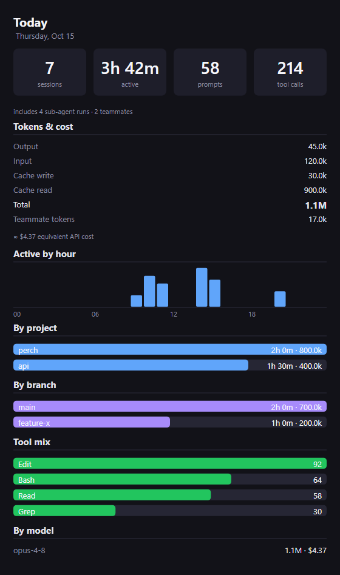
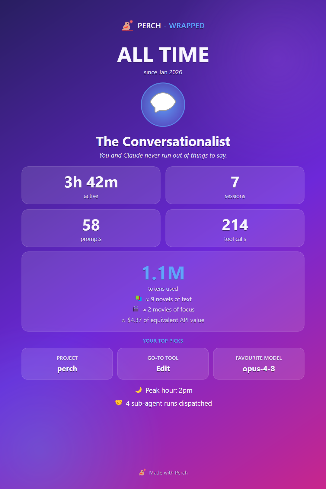

Perch reads your Claude Code transcripts and turns them into a stats dashboard and a set of lifetime
achievements. Everything is worked out locally from the files in `~/.claude`.

## Open the stats dashboard

Right-click the tray icon and choose **Session stats…**, or go to **Settings → Session Stats → Open session
stats…**.

Pick a range from the toolbar: **Today**, **7 days**, **30 days** or **All time**.

## What the dashboard shows

- **Headline cards:** sessions, active time, prompts and tool calls. A note underneath counts sub-agent runs
  and teammates when there are any.
- **Records** (7 days, 30 days and All time): the number of active days, your busiest day and your longest
  session. All time also shows your current streak of consecutive active days.
- **Daily trend** (7 days, 30 days and All time): active time per day.
- **Tokens & cost:** output, input, cache write, cache read and the total, plus teammate tokens when there
  are any. Below it, an estimated equivalent API cost.
- **Active by hour:** when in the day you worked.
- **By project** and **By branch:** active time and tokens for each. The branch list only appears when more
  than one branch was used.
- **Tool mix:** your most-used tools.
- **By model:** tokens and estimated cost for each model.

### Active time

Active time is estimated from the gaps between transcript records. A gap longer than the idle threshold
(5 minutes by default) counts as you having stepped away, and is capped at the threshold. Change it with
**Active-time idle threshold**.

### Estimated cost

The cost figure is what the tokens would have cost at pay-as-you-go API prices, using built-in per-model
rates. It is a measure of how hard you used Claude, not a bill: subscription usage is not charged per token.
It reads "(partial)" when some models have no price, and you can hide it with **Estimated cost**.

## Make a Wrapped poster

The **Wrapped** button on the stats toolbar turns the current range into a shareable poster. It is enabled
once the range has at least one session.

The poster shows a persona for how you work, your headline numbers, total tokens, your top project, tool and
model, and your peak hour. The estimated cost is included only when **Estimated cost** is on. Click
**Copy image** to put it on the clipboard or **Save PNG…** to save it.

Check the poster before you share it: it names your top project.

## Achievements

Achievements are trophies earned from your lifetime Claude Code activity. They are worked out from your
whole history, so they unlock retroactively: what you did before installing Perch already counts.

Open the trophy cabinet from the tray menu (**Achievements…**) or from **Settings → Achievements → Open
achievements…**. A search box at the top filters the badges. The All time range of the stats dashboard also
shows a compact version.

### How badges work

- Badges are grouped by theme: **Tokens**, **Activity**, **Tools**, **Collaboration**, **Rhythm** and
  **Whoops**. Each group shows how many of its badges you have unlocked.
- Many badges have levels. For example, the sessions badge climbs from your first session up to 1,000
  sessions, and the streak badge from a 3-day streak to a 100-day one. The tile shows your current level and
  a bar towards the next.
- Single badges show their goal, and a progress bar when there is a count to work towards.
- Badges come in bronze, silver and gold tiers.
- The spend badges only appear when **Estimated cost** is on.

What they cover, in general terms:

| Group | Examples of what counts |
| --- | --- |
| Tokens | Input, output and cached tokens, and reading more from cache than you send fresh |
| Activity | Sessions, prompts, active hours, streaks, active days, your longest session, equivalent spend |
| Tools | Total tool calls, how many different tools and model families you use, heavy use of one tool |
| Collaboration | Sub-agents, teammates, projects and branches |
| Rhythm | When in the day you work |
| Whoops | Prompts you cancelled and typed again |

### When you unlock one

Perch checks for new unlocks when it starts and each time a session finishes.

- Crossing a gold-tier badge plays a full-screen card reveal. Up to three cards show side by side, with a
  "+N more" card for a bigger batch. **Don't show again** on the card turns off **Achievement reveal card**.
- **Achievement toasts** also pops a desktop notification for each unlock, or one summary for a big batch.
  It is off by default.

On a fresh install, unlocks from your existing history are recorded quietly rather than celebrated, so they
don't cover the Quick Start.

Both celebrations count as playful extras, so [Quiet mode](/perch/features/alerts/) holds them back while it
is on.

## Settings

| Setting | What it does |
| --- | --- |
| Estimated cost | Shows the equivalent API cost in the stats window and on the Wrapped poster. |
| Active-time idle threshold | Gaps longer than this count as stepped away rather than active. |
| Achievement reveal card | Plays the full-screen card reveal when a gold-tier badge unlocks. |
| Achievement toasts | Also pops a desktop toast for each unlock. |

## Related

- [History & search](/perch/features/history-search/)
- [Usage & limits](/perch/features/usage-limits/)
- [Appearance & settings](/perch/features/appearance/)
