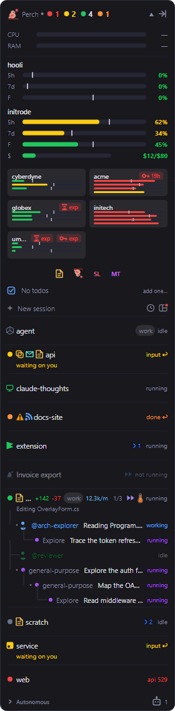

A session that hits a rate limit stops and waits, which is one more way it can end up needing you. The usage
strip on the overlay panel shows how close each of your Claude accounts is to its limits, and whether you're
using them faster than the time window allows.

## Read the bars

Each account gets a heading with its name, and a bar for each limit:

| Bar | What it measures |
| --- | --- |
| `5h` | The 5-hour session window. |
| `7d` | The weekly window. |
| One per model | Any extra weekly window that applies to a single model, captioned with a short form of the model's name. |
| `$` | This month's extra-usage spend against your monthly limit, shown in dollars. Only with Monthly spend on (see below). |

The number on the right is how much of the limit you've used.

**The marker.** Each time-window bar has a thin tick across it. It marks where you'd be if you used the limit
at a steady rate across the whole window. Halfway through the week, the weekly marker sits at 50%.

**The colour.** A time-window bar is coloured by how your usage compares with that marker, not by how full it
is:

- **Green**: more than 10 points behind the marker. You have room.
- **Yellow**: from 10 points behind to 1 point ahead. You're roughly on pace.
- **Red**: more than 1 point ahead of the marker. At this rate you'll run out before the window resets.

Early in a window, before 15% of it has passed, the bar stays green, so a small burst of work doesn't turn it
red.

So a weekly bar at 60% can be green on day six and red on day two. The spend bar has no window to pace
against, so it's coloured by how full it is: green, then yellow from 50%, orange from 75% and red from 90%.

**Reset times.** Hover the strip for a tooltip that lists each limit with its percentage and how long until it
resets. With more than one account, hover an account's bars to see just that account.

## Monthly spend

If you've turned on extra usage for your Claude account, Perch can show what you've spent this month against
your monthly limit. Turn on **Monthly spend**. The `$` bar then appears for each account that has extra usage
switched on, and stays hidden for accounts that don't.

## More than one account

When Perch watches more than one Claude config directory (see [Accounts](/perch/features/accounts/)), the strip
has a section for each account:

- Accounts in use, meaning ones with a running session, plus your default account, show full bars.
- Accounts Perch knows about but that have no running session show as compact tiles: the account name over
  tiny bars with the same colours and markers, but no captions or numbers.
- **Click an account's name** to fold it into a tile. **Click a tile** to open it out again. Perch remembers
  your choice for each account.
- If two config directories are signed in to the same account, it's shown once.

Perch refreshes the accounts in use every 5 minutes, and the idle ones about every 15 minutes.

## When the numbers are out of date

Perch checks usage every 5 minutes. If a reading is more than 6 minutes old, or the last check failed, the
account's bars are dimmed. The tooltip then says why: the error, how long ago the last good reading was,
or "No usage data yet" before the first check has come back.

Perch reads usage with your Claude Code sign-in. If that account's access token has expired, the check can't
run until Claude Code refreshes it, and the tooltip says so. With **Sign-in expiry** on, the account's
heading also shows a red chip when its access token or login is about to run out. See
[Alerts & notifications](/perch/features/alerts/#sign-in-expiry).

## Turn the bars on and off

Perch only calls Claude's usage endpoint while **Usage bars** is on. Turn it off and the checks stop.

You can also right-click the usage strip and choose **Hide usage**, and bring it back from the overlay header's
right-click menu with **Show usage**.

## System metrics

Perch can also show how hard your machine is working.

- **System metrics** adds a CPU and RAM strip to the panel, coloured by load from green to red. CPU shows a dash
  for a moment after you turn it on, until Perch has two readings to compare.
- **Per-session metrics** adds a small CPU and memory bar to each session row. Hover it for the CPU
  percentage, the memory used and, when there's more than one, the number of processes.
- **Include subprocesses** counts everything a session has started (its shells, tools and MCP servers) in that
  session's numbers, not just the Claude process itself.

All three are off by default, and Perch doesn't sample anything until you turn one on. Right-click the system
strip to hide it, or use **Show system metrics** on the header's right-click menu.

The system metrics and usage strips are sections of the panel, so you can move them. See
[Reorder the sections](/perch/features/overlay-panel/#reorder-the-sections).

## Settings

Open **Settings** from the tray menu. Type a setting's name into **Search** to find it, or browse **Features**,
where a live preview shows the effect.

| Setting | What it does |
| --- | --- |
| Usage bars | Shows the 5-hour, weekly and per-model bars, and turns the usage checks on. On by default. |
| Monthly spend | Shows the monthly extra-usage spend bar for accounts that have extra usage on. Off by default. |
| Sign-in expiry | Shows countdown chips when an account's access token or login is about to expire. On by default. |
| System metrics | Shows the whole-machine CPU and RAM strip. Off by default. |
| Per-session metrics | Shows a CPU and RAM bar on each session row. Off by default. |
| Include subprocesses | Adds a session's child processes to its numbers. Off by default. |

## Related

- [Overlay panel](/perch/features/overlay-panel/)
- [Accounts](/perch/features/accounts/)
- [Alerts & notifications](/perch/features/alerts/)
- [Stats & achievements](/perch/features/stats-achievements/)
