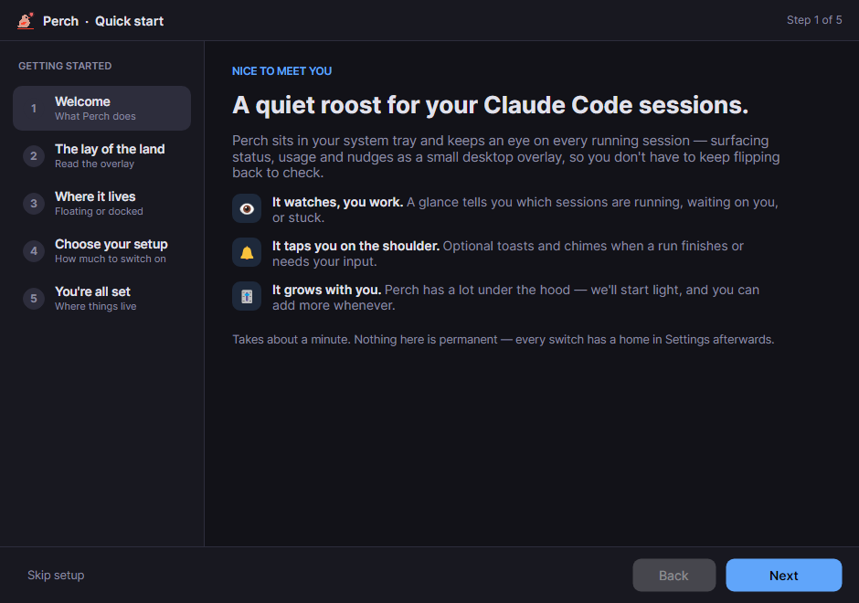
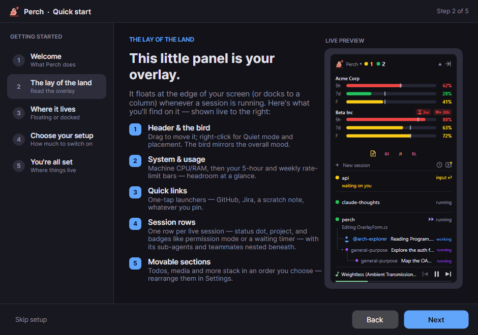
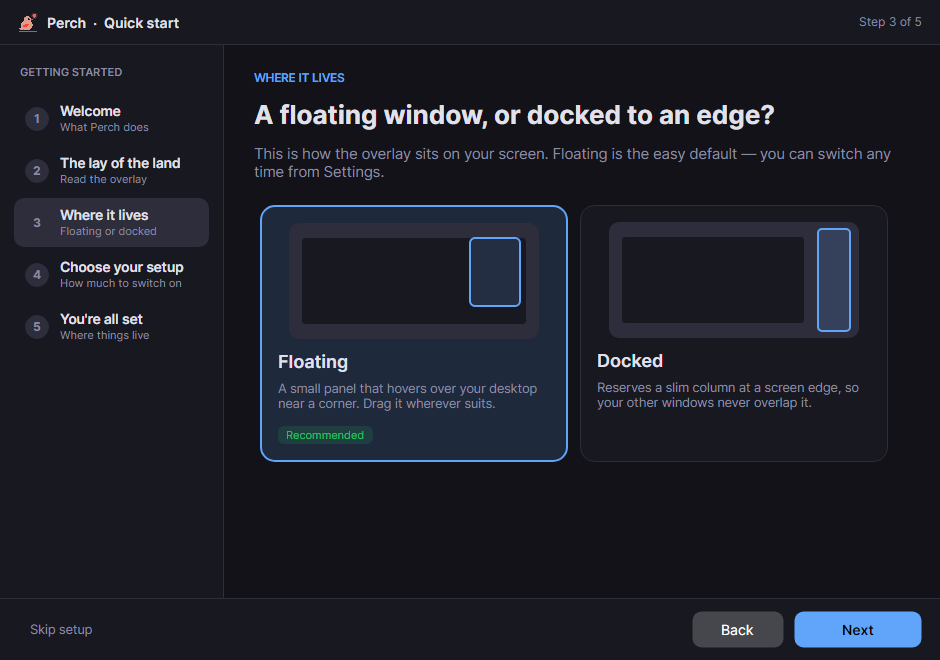
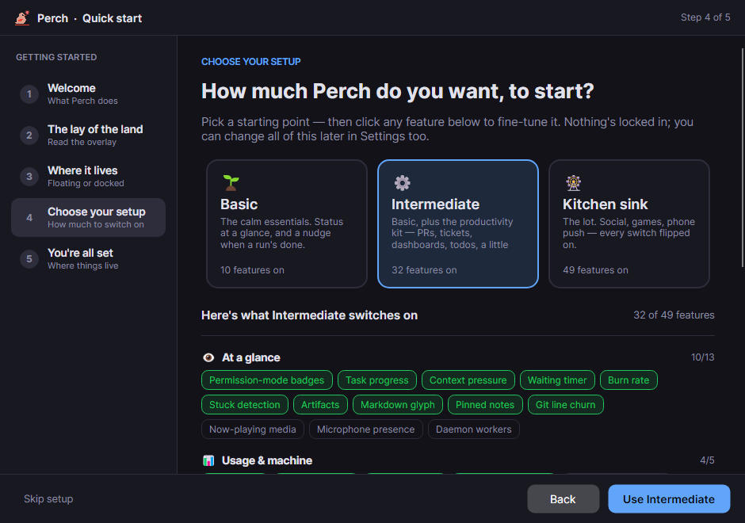

Perch has a lot of features, and you don't need most of them on day one. The first time it starts, a short
**Quick Start** asks how much you want switched on, so you can begin with the essentials and add more later.
It takes about a minute, and nothing in it is permanent.

## What happens when Perch first starts

1. **It appears in the tray** (the menu bar on macOS). There's no main window. Left-click the icon for
   Settings, right-click it for the full menu.
2. **It connects to Claude Code.** Perch adds a few hooks to Claude Code's `settings.json` that point at its own
   small `perch-hook` program. There's no plugin to install, and uninstalling Perch removes them.
3. **On macOS, you may see two one-time prompts:** **Notifications**, for session alerts, and **Automation**
   (control Terminal), so clicking a session can focus its exact window. Both are optional. Perch also links
   the `perch` command into `~/.local/bin`.
4. **The Quick Start opens.** It only appears once, on a fresh install. If you're upgrading from an older
   version, you won't see it, and your settings are left alone.

## The Quick Start, step by step

Use **Next** and **Back**, or the left and right arrow keys. You can also click any step in the left-hand list.

### 1. Welcome

What Perch does, in three lines: it watches your sessions, taps you on the shoulder when one needs you, and
starts light.

### 2. The lay of the land

A labelled tour of the panel, with a live preview next to it: the header, the system and usage bars, quick
links, one row per session, and the sections you can reorder later.

### 3. Where it lives

Choose how the panel sits on your screen:

- **Floating** (recommended): a small panel near a corner of your screen that you can drag anywhere.
- **Docked**: reserves a slim column at a screen edge, so other windows never cover it. Windows only.

### 4. Choose your setup

Pick a starting point. Each one includes everything in the one before it:

| Setup | Features on | What you get |
| --- | --- | --- |
| **Basic** | 10 | The calm essentials: status at a glance, usage bars, and a notification when a session is done or waiting. No sounds. |
| **Intermediate** | 32 | Basic, plus chimes, more detail on each row, pull-request and Jira signals, to-dos and a little fun. |
| **Kitchen sink** | 49 | Everything, including phone push, the friends feed and achievement toasts. |

Under the cards is the full list of what your choice switches on, grouped by area. **Click any feature to turn
it on or off**; your mix then shows as "custom". If you're not sure, start with **Basic**. It's easy to add
things later and harder to notice what you'd turn off.

Exactly what each setup turns on

| Group | Basic | Intermediate adds | Kitchen sink adds |
| --- | --- | --- | --- |
| At a glance | Permission-mode badges, Task progress, Context pressure, Waiting timer | Burn rate, Stuck detection, Artifacts, Markdown glyph, Pinned notes, Git line churn | Now-playing media, Microphone presence, Daemon workers |
| Usage & machine | Usage bars, System metrics | Monthly spend, Per-session metrics | Service status footer |
| Alerts | Desktop notifications, Notify when done, Notify when waiting for input | Chime when done, Chime when waiting, Notify on API error, Notify when a PR finishes, is reviewed, or is approved, Todo reminders | Chimes for API errors and PR events, Flash a PR state banner, External push (ntfy), Push while screen locked, Notify when a friend posts, Notify when challenged to a game |
| Stats & tools | Today's stats in tray | Estimated cost, Todos | |
| Integrations | | Hypertree, Pull requests, Jira ticket | |
| Fun & social | | Perch reacts, Achievement reveal card | Achievement toasts, Upside-down quick links, Social feed, Show large reactions |

The Quick Start only manages these switches. It never changes anything else, such as thresholds, your quick
links or your accounts.

### 5. You're all set

A summary of what you picked. Click **Finish setup** to apply it straight away; there's no need to restart.
The panel appears the next time a Claude Code session starts.

## Skipping it

**Skip setup**, the window's close button and **Esc** all count as "seen": the Quick Start won't come back on
its own, and Perch keeps its default settings.

## Changing your mind later

- **Run the Quick Start again** from **Settings → Getting started**. It only resets the switches listed above,
  so anything else you've changed since stays as it is.
- **Find any single setting** by typing in the search box at the top of Settings, for example "chime" or
  "docked".
- **Reorder the panel** by dragging its sections in the Settings preview.

## Next

Start a Claude Code session in any terminal and watch it appear in the panel. Then read
[the panel](/perch/features/overlay-panel/) and [alerts](/perch/features/alerts/) to see what each part means.
